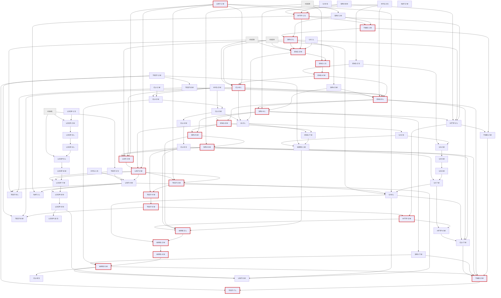

# Murlan design audit: integrated target architecture and ticket plan

Integrates the eleven designs in `designs/01-engine.md` … `designs/11-loop.md` and the hygiene/native ledger
rows L-217..L-238 against MAIN `a1d0ebb5` (`scratchpad/main2`). Ledger: `phase0/ledger.verified.json`
(238 rows; 11 dropped: L-018, L-033, L-045, L-072, L-079, L-080, L-092, L-111, L-151, L-162, L-193).
Open tickets read on 2026-10-16: #1624 (in progress, PR #1649), #1628, #1639, #1641 (open); #1640,
#1603, #1604, #1626/#1638 (merged).

Read this as a whole-system plan: where two designs reached for the same seam, one of them yields and
the other is reshaped (section 2). Each row in section 3 is one fresh loop session and one PR. The
blocked-by column, section 5 and section 7 are generated and checked by
`scratchpad/integrate-check.mjs`, which is a copy kept beside this file as `integrate-check.mjs`.

---

## 1. Target architecture

Six layers. Each arrow is an import that is allowed; no other import is allowed, and a lint guard or
`deepEqual` scan with a floor holds each line.

```
 app/ screens ──► context/ (providers, drivers) ──► components/ (table, presentation models)
        │                 │                                │
        ▼                 ▼                                ▼
   lib/ (client libs: lib/timeline, lib/motion.ts, lib/platform.ts, lib/tutorial, lib/queries)
        │
        ▼
   lib/game/ (rules + bot; pure)  ◄── shared/ (wire: protocol, http contract, gameStateSchema)
        ▲                                   ▲
        └────────── server/game (tables) ◄──┴── server/socket, server/http (transports)
                         │
                         ▼
                    server/store (rows), server/clock.ts, server/shared (refusal, payload, logger)
```

**The game (`lib/game/`).** It is pure and holds only the game. Motion timelines move to `lib/timeline/`
and the boundary test keeps them out (ENG-3). It owns four parts.

- **One deal.** `startRound(seats, mode, {firstSeat, opening, dealt, random})` replaces
  `initializeGame`/`initializeRematch`. A seat's team is derived from the seat; `modeFits` states the
  teams rule (ENG-5).
- **One move.** `applyMove(state, seat, Move): MoveResult` checks phase, then the turn, then the move,
  and refuses with a `MoveRefusal`. It is the only writer of `GameState.lastMove`, apart from
  `startRound`, which writes the deal (ENG-6, WIRE-1).
- **One bot.** `botView` plus `botChoosePlay(view, rng)` and the giveback choice. `autoMoveForSeat` is
  the one call site the server and the offline driver both use, and it returns `{state, move}` (ENG-7,
  CLAUDE.md invariant).
- **Scoring as data.** `foldRound(round, ledger, SeatScoring[])` and `lib/game/matchFlow.ts` (ENG-4).
  There is no stuck-exchange valve: a dealt round cannot reach that state, and both restore seams
  refuse an unsatisfiable exchange (ENG-7, WIRE-3).

**The wire (`shared/`).**
- `protocol.ts` hashes the expanded wire types (WIRE-1).
- `gameStateSchema.ts` parses every stored or received `GameState`, and `roundOverSchema` is parsed
  whole (WIRE-3).
- `http.ts` is the HTTP contract table used by both sides (HTTP-1, HTTP-2).
- The rules for a `PROTOCOL_VERSION` bump are in section 2, R1.

**The server table (`server/game/`).**
- `tableRuntime.ts` builds a `TableRuntime` from `TablePorts = {out, presence, writers, transport,
  store}`. `store` is `activeGameStore` plus `TableRoomPort` (SRV-3, SRV-4).
- The clock is ambient (`server/clock.ts`, TIME-1) and is not a port.
- Handlers return `Outcome` values; `onEvent` alone emits a refusal (SRV-2).
- `tableHandlers.ts` splits into `tableMoves` (hosts ENG-6's `commitMove`), `tableVotes` and
  `tableLifecycle` (SRV-5).
- Each field has one writer (`matchLedger`, `seatLedger`; SRV-6), and retention lives only in
  `retention.ts` (SRV-7).
- Lifecycle invariant: no row write after the room's lock is released (SRV-1).

**Persistence.** `server/store/db.ts` opens at boot through `openDatabase`, and nothing reads env at
import (TIME-2, TIME-3). `activeGameStore` is the only writer of `active_games`.

**The client.**
- *Online.* `OnlineGameProvider` holds one `resetTable`, a `useRejoin` hook and slice hooks. Navigation
  comes from one `useOnlineRouting`. `SocketContext` is split three ways (CLI-1..CLI-5).
- *Offline.* `GameContext` holds an `OfflineTable` behind one `commit`, and `context/offlineDriver.ts`
  runs bots and timers off the screen (CLI-6, ENG-5).
- *HTTP.* Calls go through `useApi`/`api()` keyed by the contract (HTTP-3, HTTP-4).

**The table UI (`components/`).**
- `tableLayout()` and `Seating` are built once (UI-2), and `layoutHandRow` lays out the hand row
  (UI-1).
- Presentation models (`turnState`, `tableVeils`, `useTableFloat`, `matchBoardFor`) leave GameTable
  holding only wiring (UI-4).
- `GameTable` reads `lastMove` instead of diffing states (WIRE-2).
- Motion goes through `lib/motion.ts` (UI-8), and platform quirks through `lib/platform.ts` (UI-7).

**Tests.**
- One fixture module, `tests/support/game.ts` (`card`, `joker`, `seat`, `state`, `rng`), serves every
  tier (TEST-1).
- Native tests render the real providers over `FakeSocket`/`FakeHttp` via `renderApp` (TEST-4..TEST-6).
- Integration tests use typed sockets and wait on acks (TEST-7).
- e2e seeds saves through the typed builder (TEST-8).
- Static rules live in one guard registry, `eslint.guards.cjs`, with a floor (LINT-1). Scans that stay
  share one walker (LINT-3).

**The loop.** `tracker.mjs` is the only GitHub client, `decide()` owns routing, `limits.mjs` holds every
cap, `session-env.mjs` owns `LOOP_*`, and `scripts/lib/proc.mjs` spawns processes (LOOP-1..LOOP-9). CI
scope is a module (LOOP-7).

---

## 2. Cross-area resolutions

**R1. Protocol bumps.** `tests/server/protocolVersion.test.ts:24-49` pins one hash per
`PROTOCOL_VERSION` in `tests/fixtures/protocolHashes.json`, so every token change to
`shared/protocol.ts` needs its own bump. Fewer wire changes therefore means fewer PRs that touch the
wire. The fix is to merge wire changes made for the same reason, and to raise `MIN` only where a field
an old bundle reads is removed or reshaped.

| Order | Ticket | Wire change | PROTOCOL / MIN (from 6/6) | Persisted versions |
|---|---|---|---|---|
| 1 | HTTP-1 | delete dead `ServerPayload.error` (no producer) | 7 / 6 | — |
| 2 | WIRE-1 | add `lastMove`; the hash expands to the wire types | 8 / 6 | schema +1, offline +1 |
| 3 | WIRE-3 | `gameStateSchema` (`playedRanks` required) + full `roundOverSchema` (S-OUT-5 folded in) | 9 / 6 | schema +1, offline +1 |
| 4 | WIRE-4 | `openingCard`/`tableDemand`; drop `firstPlayMade`, `startCard`, `trickWinner` | 10 / **10** | schema +1, offline +1 |
| 5 | WIRE-5 | `ExchangePhase` union, typed `WireExchangePhase` | 11 / **11** | schema +1, offline +1 (the design omitted this; the stored shape changes) |

- **The numbers are relative.** Each ticket bumps by one from main and states its MIN rule. The table
  shows the numbers under the planned order.
- **Earlier version bumps.** ENG-1 raises schema to 4 and ENG-5 raises the offline save to 4 before
  this chain starts.
- **Bump count.** The designs had six wire bumps: http T1, S-OUT-5, T1a, E8 (its `playedRanks` change
  moves the expanded hash), T1b and E9. This plan has five, with two MIN raises.
- **Deploy order.** Server first, per `shared/protocol.ts:1-3`.
- **TEST-8 lands before ENG-5.** After that, each save bump is one constant plus one
  `tests/fixtures/offlineSave.v<N>.json` written by `encodeOfflineSave`, not 11 hand-written e2e saves.

**R2. One serial order through `lib/game/gameEngine.ts`.** Every ticket that edits the engine runs in
this order:

ENG-2 → ENG-3 → ENG-1 → ENG-4 → ENG-5 → ENG-6 → ENG-7 → WIRE-1 → WIRE-3 → WIRE-2 → WIRE-4 → WIRE-5

- **Folded into ENG-5.** Time T3 (`DealOptions.random`) folds into ENG-5's `startRound` options, so no
  ticket adds a parameter to `initializeGame` that ENG-5 then deletes. C6's `modeFits` also moves into
  ENG-5; it sits beside `TEAMS_PLAYER_COUNT` (`gameEngine.ts:1068`).
- **Kept separate.** lastMove T1a is not merged into E6, since the two together exceed L. It lands
  after ENG-7, so `applyMove` and `startRound` exist and are the only writers. The `stuckRelease` kind
  is gone because ENG-7 deleted the valve.
- **Order changed.** E3 is no longer blocked by E1. ENG-1 is a five-line restore change and rebases
  onto the move.

**R3. L-006: deleting `resolveStuckExchange`, and turn ownership in `applyMove`.** Neither is a rule
change.

- **The valve covers an unreachable state.**
  - The valve is `lib/game/autoMove.ts:43`, called at `:89`, `app/game.tsx:147-153`,
    `context/GameContext.tsx` and `context/gameHooks.ts`, `lib/diagnostics/benchTable.ts`,
    `tests/native/helpers/botRound.ts`, and `tests/server/stuckExchange.test.ts`.
  - GAME-RULES § Decisions, "What the winner may hand back", plus §10 make the winner's legal giveback
    set empty only for an empty hand. A dealt round never reaches that state.
  - #1638 kept the valve working while saying "None of these changes a rule". No decision row names
    the valve; only `docs/ARCHITECTURE.md:299` does.
- **What ENG-7 ships instead.** ENG-7 deletes the valve only in the same PR that makes both restore
  seams refuse an unsatisfiable exchange (`exchangeIsSatisfiable`). The tests come red first: an
  empty-winner exchange restores at MAIN. WIRE-3 later expresses that refusal as a `parseGameState`
  reason.
- **Turn ownership.** `applyMove` refusing `notYourTurn` matches the server today, which already
  refuses `NOT_YOUR_TURN` in `server/game/tableHandlers.ts`. The `gameEngine.ts:463-466` comment is a
  code note, not a decision.
- **Decision.** Both are listed as owner decisions D1/D2 with default "proceed". They do not block.
  GAME-RULES gets pointer edits only.
- **`gameRuleDecisions.test.ts` does not guard this.** That test (`tests/tooling/gameRuleDecisions.test.ts:11-20`)
  only pins the BRIEF → GAME-RULES migration, so LINT-3 can delete it as designed without losing a
  rules guard.

**R4. Server ports and the server order.** One `TablePorts`, built once:

- `{out, presence, writers, transport}` come from server-output.
- `store: {games: ActiveGameStore, rooms: TableRoomPort}` comes from server-runtime T2. It lands
  *before* the runtime, so the constructor never changes twice.
- The clock is not a port. `server/clock.ts` (TIME-1) is ambient because the seat-hold, router and
  rate sites sit outside any table. SRV-4 deletes S-OUT's "time adds clock" comment.
- E6's server `moveAction`/`commitMove` and S-OUT-4's `decideMove` are one thing. ENG-6 lands first,
  and SRV-5's `tableMoves.ts` hosts `commitMove`/`moveAction` over `applyMove`. No `decideMove` is
  built.

The server order:

#1628 → SRV-1 (lifecycle defects, small) → TIME-1 → SRV-2 → SRV-3 → ENG-5 → SRV-4 (runtime) → ENG-6 →
SRV-5 (split) → SRV-6 (single writers) → TIME-3 (late, quiet window: about 124 sites).

ENG-5 comes before SRV-4 because ENG-5's `dealVotedRound`/`roundOver`/`socketTable` edits are small
and SRV-4 rewrites those signatures anyway.

- SRV-7 (retention) follows SRV-4, and SRV-8 (stall hygiene) is free.
- The designs disagreed: server-output wanted the runtime first, server-runtime wanted T1 first. T1
  wins. It fixes live defects in small diffs (memory: stability first), and SRV-4 carries its
  `stopTables` into the runtime.

**R5. One fixture home, landed first.**
- TEST-1 (harness T6) creates `tests/support/game.ts` with no blockers. WIRE-1 and WIRE-3 depend on
  `state()`, and ENG-5 depends on `rng`.
- Time's `tests/helpers/seededRandom.ts` is not created. `rng(seed)` in `tests/support/game.ts`
  exposes both shapes: `rng.next(): number` for the bot and `rng.source: RandomSource` (the
  `getRandomValues(Uint32Array)` shape) for the deal. There is one `mulberry32` behind them.
- `tests/engine/helpers.ts` is deleted. ENG-7's `playRoundOut` lands in `tests/support/game.ts`.

**R6. Providers and lint guards.**
- **Client before harness.** The client chain (CLI-1 → CLI-5) runs before the native harness migration
  (TEST-4 → TEST-6), for two reasons. #1641 already holds the harness back. And TEST-4's
  `context/AppProviders.tsx` is a pure move of `app/_layout.tsx`'s provider order, which CLI-4 and
  CLI-5 reshape.
- **Where the harness comes first.** TEST-5 (account-side `renderApp`) lands before HTTP-3, so HTTP-3
  and HTTP-4 change behaviour under real providers rather than under `@/lib/query-client` mocks.
- **TEST-6** needs the slice re-export (CLI-2) and the offline split (CLI-6), as in design 09.
- **LINT-1 (`eslint.guards.cjs`) comes before every new lint ban.** Each ban is written as a registry
  guard with plant/spare samples, never as a loose `eslint.config.js` block:

  | Ban | Ticket |
  |---|---|
  | layer bans | HTTP-1 |
  | e2e flag reader | CLI-6 |
  | `withRepeat` outside `lib/motion.ts` | UI-8 |
  | module mocks | TEST-3, TEST-4 |
  | `GROUP_OWNERS` audio change | NAT-1 |
  | `submit-through-hook`, `codes-through-payload` | LINT-2 |

**R7. The GameTable / `app/game.tsx` chain.** One serial line, outside work first:

#1624 → #1639 → (UI-1) → ENG-3 → UI-2 → UI-3 → UI-4 → UI-5 → UI-6 → UI-7 → UI-8 → WIRE-2 → WIRE-4 → WIRE-5

- CLI-6 (offline driver out of `app/game.tsx`) waits for #1624 and #1639, then ENG-5/ENG-7 build on
  the driver.
- UI-2 moves `turnKey` and the pass/trick helpers out of `flightPhysics.ts` verbatim. WIRE-2 then
  deletes them. That costs three moved functions, but UI work no longer waits behind the engine chain.

**R8. Workflows and `ci.yml`.** Order of edits to `.github/workflows/*`:

TEST-2 (harness-leg floor for `deleteBranchOnMerge`) → LOOP-7 (`scope.mjs` replaces `ci.yml:52-150`;
also after LINT-3, which touches `ciScope.test.ts`) → LOOP-8 (one install action, all workflows; also
after LINT-4, whose `tests/helpers/workflow.ts` it uses).

- LOOP-8 uses LINT-4's `workflow.ts` reader.
- `package.json` changes go HYG-1 → LINT-4 (`fontverter`) → LOOP-9 (script entries).

**R9. Overlaps settled.**

| Overlap | Settlement |
|---|---|
| E3's `lib/motion/` directory and UI-8's `lib/motion.ts` (same name) | The timelines go to `lib/timeline/` (neither exists at MAIN). |
| C5a's `settleExchange` and E7 | CLI-6 moves the giveback/stuck logic from the screen into `settleExchange` in `context/offlineDriver.ts`, unchanged. ENG-7 then routes the giveback through `runBotTurn` and deletes the stuck branch. |
| Static-checks wants `cardMemoComparators.test.tsx` typed with `satisfies`; UI-3 deletes it | UI-3 deletes it and keeps a behavioural no-re-render test. LINT-2 drops that bullet. |
| Time T4 (acks in `tests/helpers/client.ts`) and harness T7 (typed sockets, same helper) | Merged into TEST-7, behind TIME-3, which edits the same integration files. |
| lastMove T4 (`playAnyLegal`, sentinels) and harness T9 (e2e helpers) | Merged into TEST-9, as design 02 suggested. |
| S-OUT-2 (lobby port) and S-OUT-1 (refusals) | Both change the socket handler contract in the same files, so they are merged into SRV-2 (L). |
| T5a and T5b (both split `queue-loop.mjs`) | Merged into LOOP-5 (L). |
| L-234 (platform twins) and table-ui T7 (platform seam) | Merged into UI-7. |
| L-226 (`dealDelay` comment) | Goes into UI-1, which deletes `dealDelay`. |
| L-220 (`LampRig.flare`/`kick` with no caller) | Goes into UI-5 (lamp holds). |
| L-227 (press comments, `BTN_PRESS_SCALE`) | Goes into UI-8 (`usePressScale`). |
| L-229's `mail.ts:101-104` sentence | SRV-8 already deletes it (L-038). HYG-3 does the rest of L-229. |
| L-162 (dropped) | Its `soak.yml` Postgres-pin remnant still rides in LOOP-8 and is not counted. |

**R10. Owner-eye tickets.**
- **The tickets.** UI-3 (tutorial card, joker unchanged), UI-6 (chip resumes from true remaining
  time), UI-7 (settings rows), UI-8 (reduced-motion fade, L-105), UI-9 (web particles idle) and CLI-7
  (it/sq mode wording).
- **How they run.** Each is `ready-for-agent`. Its DoD ends with "before/after captures in the PR body;
  the PR is left for the owner to merge".
- **L-107 (joker rank size)** is not built. It stays an owner decision (D13).

**R11. One ticket at a time.** How the edges were set:

- **Same-file edges are derived, not hand-picked.** The check script takes one priority order:
  stability first, the #1624/#1639 follow-ups, then feel, then internals. For every pair of tickets
  that name the same file (or one's directory), it adds an edge from the earlier ticket to the later.
  It adds 29 such edges and skips any edge already implied by another path.
- **Hand-set edges must agree with that order.** The script fails if one contradicts it.
- **`eslint.guards.cjs` is not exempt.** It is shared, so guard-adding tickets are ordered too.

The loop runs one ticket at a time (memory: one ticket at a time). The
waves in section 5 are dependency layers, not parallel lanes. An edge is drawn wherever two tickets
share a file (checked mechanically, section 7) or one builds on the other's shape.

---

## 3. Final ticket table

Labels: every ticket is `ready-for-agent` plus `size:*`, except LOOP-10 (`ready-for-human`). LOOP-*
also carry `loop`. External blockers (#n) are native blocked-by edges as well.

| ID | title | area | size | ledger IDs | files/modules | blocked by | label | owner-eye? |
|---|---|---|---|---|---|---|---|---|
| ENG-1 | Restore reads the persisted match verdict | engine | S | L-001 | shared/persistedEnvelope.ts, server/game/tableState.ts, server/game/onlineGameLogic.ts | ENG-3, #1628 | ready-for-agent | no |
| ENG-2 | GIOCA's refusal is the engine's code | engine | S | L-088 | lib/game/gameEngine.ts, components/table/stagedPlay.ts, components/turnTimerUi.ts, components/table/spokenLabels.ts, components/tutorialRefusal.ts | HYG-3 | ready-for-agent | no |
| ENG-3 | lib/game holds only the game; timelines move to lib/timeline/ | engine | M | L-015, L-013 (part) | lib/game/{dealTimeline,exchangeTimeline,roundEnding,matchEnding,offlineBotDelay,placement}.ts, lib/timeline/ (new), lib/exchangeCeremony.ts (deleted), server/game/gameTurn.ts, server/game/onlineGameLogic.ts, components/GameTable.tsx, components/table/hand.tsx, app/game.tsx | UI-1, HTTP-1, SRV-2, #1624, #1639 | ready-for-agent | no |
| ENG-4 | Scoring takes seats as data; match flow leaves the provider | engine | M | L-002, L-007, L-014, L-016, L-144, L-013 (part), L-146 (part) | lib/game/gameEngine.ts, lib/game/matchFlow.ts (new), lib/game/botSeat.ts (new), lib/game/rating.ts, server/game/{onlineGameLogic,gameTurn,stats,roundOver}.ts, context/GameContext.tsx, tests/helpers/offlineMatch.ts | ENG-1, ENG-2 | ready-for-agent | no |
| ENG-5 | One deal: startRound with seat-derived team, injected randomness, modeFits | engine | L | L-004, L-008, L-021, L-019 (part), L-086 (part), L-012 (part), L-146 (part) | lib/game/{gameEngine,matchFlow,matchState}.ts, context/GameContext.tsx, lib/offlineSave.ts, app/lobby.tsx, server/game/{tableHandlers,tableState,gameRoom,roundOver}.ts, server/socket/socketTable.ts, lib/e2eOpener.ts, lib/diagnostics/benchTable.ts, tests/helpers/{liveGame,offlineMatch}.ts, tests/integration/gameplay.test.ts | ENG-4, CLI-6, HYG-2, HYG-3, TEST-8, SRV-3 | ready-for-agent | no |
| ENG-6 | Moves are data: applyMove, a pure autoMove, one commit site | engine | M | L-010, L-011, L-013 | lib/game/{gameEngine,autoMove}.ts, server/game/{tableHandlers,gameTurn,dealRound,tableState,replayShape}.ts, context/GameContext.tsx, tests/helpers/{offlineMatch,liveGame}.ts | ENG-5, SRV-4 | ready-for-agent | no |
| ENG-7 | The bot owns every bot decision; no stuck-exchange valve | engine | M | L-003, L-006, L-017, L-146 | lib/game/{bot,autoMove,gameEngine}.ts, context/{GameContext.tsx,gameHooks.ts,offlineDriver.ts}, app/game.tsx, lib/offlineSave.ts, server/game/tableState.ts, lib/diagnostics/benchTable.ts, docs/GAME-RULES.md, docs/ARCHITECTURE.md | ENG-6, UI-2 | ready-for-agent | no |
| WIRE-1 | GameState.lastMove: every transition records itself | wire | M | L-005 | lib/game/{gameEngine,replay}.ts, shared/{protocol,persistedEnvelope}.ts, lib/offlineSave.ts, lib/captureStates.ts, lib/e2eOpener.ts, app/tutorial.tsx | ENG-7, TEST-1, UI-3 | ready-for-agent | no |
| WIRE-2 | The table reads the move instead of diffing for it | wire | M | L-070 | context/{GameContext.tsx,offlineDriver.ts}, components/GameTable.tsx, components/useTableFeedback.ts, components/table/pile.tsx, lib/game/moves.ts (new), lib/game/sharedGameFlow.ts, server/game/gameTurn.ts, tests/helpers/offlineMatch.ts | WIRE-3, UI-8 | ready-for-agent | no |
| WIRE-3 | Game payloads are parsed whole at every boundary | wire | L | L-012, L-055 | shared/gameStateSchema.ts (new), shared/{protocol,persistedEnvelope}.ts, lib/offlineSave.ts, lib/game/{gameEngine,bot,matchState}.ts, context/OnlineGameContext.tsx | WIRE-1, SRV-5, CLI-5, HTTP-3 | ready-for-agent | no |
| WIRE-4 | One record of the table's demand: openingCard, tableDemand | wire | M | L-009 | lib/game/{gameEngine,autoMove,bot,replay}.ts, lib/captureStates.ts, components/table/{stagedPlay,spokenLabels}.ts, components/table/{handRow,selectionLeaves}.tsx, components/GameTable.tsx, server/game/tableMoves.ts, shared/{protocol,persistedEnvelope}.ts, lib/offlineSave.ts, app/tutorial.tsx | WIRE-2 | ready-for-agent | no |
| WIRE-5 | ExchangePhase is a union with a typed wire view | wire | M | L-012 (part) | lib/game/{gameEngine,autoMove,bot,sharedGameFlow}.ts, server/game/{onlineGameLogic,gameTurn,gamePersistence,tableMoves}.ts, shared/{protocol,gameStateSchema,persistedEnvelope}.ts, lib/offlineSave.ts, components/table/{exchangeModel,useTableExchange}.ts, components/GameTable.tsx, app/tutorial.tsx, context/OnlineGameContext.tsx | WIRE-4, CLI-2, SRV-7 | ready-for-agent | no |
| TIME-1 | One server clock: every time read goes through server/clock.ts | time | M | L-019 | server/clock.ts (new), server/game/{gameTimers,gameTurn,onlineGameLogic,gamePersistence,roundOver,stats,ratings,tableRouter}.ts, server/store/{roomStore,friendStore,userStore}.ts, server/socket/{socketTable,socketSafety,socketPresence,ticket,push}.ts, server/http/{routes,admin,authTokens}.ts, tests/helpers/{fakeClock,testServer}.ts | SRV-1, HTTP-1 | ready-for-agent | no |
| TIME-2 | The test server hands out its database; limits are read when used | time | M | L-020 (part) | server/http/rateLimit.ts, server/http/routes/ (dir), server/socket/socketGameplay.ts, tests/helpers/testServer.ts | TIME-1, HTTP-2 | ready-for-agent | no |
| TIME-3 | Boot opens the database; nothing reads env at import | time | M | L-020 | server/store/db.ts, server/app.ts, server/http/{session,shutdown}.ts, server/store/ (dir), server/game/ (dir), tests/helpers/testServer.ts, tests/integration/ (dir) | TIME-2, ENG-5, SRV-6, SRV-7, WIRE-5, CLI-7 | ready-for-agent | no |
| SRV-1 | Table lifecycle: no row write after its lock is gone | server | M | L-022, L-023, L-027, L-028, L-039 | server/http/shutdown.ts, server/game/{gamePersistence,gameOwnership,tableHandlers,tableRouter}.ts, server/socket/socketTable.ts | #1628 | ready-for-agent | no |
| SRV-2 | A refusal is a returned value; the lobby port is whole | server | L | L-031, L-047, L-048, L-049, L-050, L-056 | server/shared/{refusal,payload}.ts (new/moved), server/socket/{socketSafety,lobbyIntents,socketRooms,socketGameplay,socketPresence,socketTable,socketTypes,socket,payload}.ts, server/game/{tableHandlers,tableRouter,gameTurn,tableActions}.ts, server/http/{validate,errorHandler,routes}.ts | SRV-1, TIME-1 | ready-for-agent | no |
| SRV-3 | active_games has one owner: activeGameStore and a memory twin | server | M | L-024, L-127, L-136 | server/store/activeGameStore.ts (new), server/game/{gamePersistence,tableHandlers}.ts, tests/helpers/memoryTableStores.ts (new) | SRV-2 | ready-for-agent | no |
| SRV-4 | The table runtime: one output port, one writers seam, no setters | server | L | L-026, L-035, L-037 | server/game/tableRuntime.ts (new), server/socket/socketOutbox.ts (new), server/game/{tableHandlers,gameTurn,gamePersistence,roundOver,dealRound,tableRouter,gameOwnership}.ts, server/socket/{emit,socketTable,seating,socketRegistry,socket,socketGameplay,socketRooms,socketPresence}.ts, tests/helpers/recordingRuntime.ts (new) | SRV-3, SRV-8, ENG-5 | ready-for-agent | no |
| SRV-5 | tableHandlers.ts split by decision; game/ stops importing socket/ and http/ | server | M | L-025 | server/game/{tableMoves,tableVotes,tableLifecycle,tableBroadcasts}.ts (new), server/game/tableHandlers.ts, server/socket/{emit,events}.ts (moved), server/shared/{logger,events}.ts (new) | SRV-4, ENG-6 | ready-for-agent | no |
| SRV-6 | Single writers for live tables and match fields | server | M | L-032, L-036 | server/game/matchLedger.ts (new), server/socket/socketPresence.ts, server/game/{roundOver,tableVotes,gameTurn,seatLedger}.ts, tests/helpers/fieldWrites.ts (new) | SRV-5, #1628 | ready-for-agent | no |
| SRV-7 | Retention has one home, and pruning asks the cluster | server | M | L-029, L-044, L-046 | server/game/{retention,gamePersistence}.ts, server/store/roomStore.ts, server/http/deleteAccount.ts, server/socket/{ticket,lobbyIntents,socketRooms}.ts | SRV-4 | ready-for-agent | no |
| SRV-8 | DB and HTTP stall hygiene | server | M | L-030, L-038, L-040, L-041, L-042, L-043 | server/http/{routes,mail,serverErrors,clientErrors,admin}.ts, server/socket/push.ts, server/game/{dealRound,ratings}.ts, server/store/schemaDdl.ts | — | ready-for-agent | no |
| HTTP-1 | Wire types live in shared/; the layers are linted | http | S | L-052, L-129, L-053 (part) | lib/wire.ts (deleted), shared/http.ts (new), shared/protocol.ts, lib/i18n.ts, lib/game/{botPersonalities,placement,rating}.ts, lib/{achievements,cosmetics,cardNames}.ts, server/game/{ratings,stats}.ts, eslint.guards.cjs | LINT-1, SRV-8, HYG-3 | ready-for-agent | no |
| HTTP-2 | The HTTP contract on the server; routes.ts split by area | http | L | L-034, L-051, L-053, L-054 | shared/{http,httpSchemas}.ts, server/http/{access,mount,accountSession,accountMail,validate,bugReports}.ts, server/http/routes/ (dir, new), server/http/routes.ts (deleted), server/app.ts, server/socket/socket.ts | HTTP-1, SRV-2, SRV-8, SRV-4 | ready-for-agent | no |
| HTTP-3 | Client reads go through the contract | http | M | L-068 (part) | lib/{queries,query-client,ladderQuery}.ts, app/{profile,index}.tsx, app/(online)/{friends,history,leaderboard,room,replay}.tsx, context/{SocketContext,OnlineGameContext}.tsx | HTTP-2, TEST-5 | ready-for-agent | no |
| HTTP-4 | Client writes go through the contract: api() replaces apiRequest | http | M | L-068 | lib/{query-client,socket,tutorialSeen,errorReporting}.ts, lib/device/pushRegistration.ts, context/{AuthContext,SocketContext}.tsx, app/{recover,verify-email,profile}.tsx, app/(online)/friends.tsx, components/SettingsModal.tsx | HTTP-3, UI-7 | ready-for-agent | no |
| CLI-1 | Online provider: one table reset; useRejoin owns the stored handles | client | M | L-058, L-062, L-081 | context/OnlineGameContext.tsx, context/useRejoin.ts (new), lib/tableHandles.ts (new), app/index.tsx, app/(online)/index.tsx | — | ready-for-agent | no |
| CLI-2 | Online connection slice: one link subscription; notices carry a surface | client | M | L-061, L-065, L-075, L-076, L-083, L-012 (part) | lib/useOwnLink.ts, context/{OnlineGameContext.tsx,onlineGameHooks.ts}, app/(online)/{game,index,quickmatch,room}.tsx | CLI-1, HYG-2 | ready-for-agent | no |
| CLI-3 | Online navigation follows table state from one place | client | M | L-059, L-063 | context/onlineRouting.ts (new), app/(online)/{_layout,index,quickmatch,friends,room,game}.tsx | CLI-2, HYG-2 | ready-for-agent | no |
| CLI-4 | SocketContext split into connection, presence and invites | client | M | L-071, L-067 (part) | context/{SocketContext,OnlineGameContext}.tsx, lib/socket.ts, context/onlineRouting.ts, app/index.tsx, app/join/[code].tsx, app/(online)/{index,friends,room}.tsx | CLI-3 | ready-for-agent | no |
| CLI-5 | Notifications split by rate of change; a dead session is forgotten locally | client | S | L-067, L-073, L-077, L-078 | context/{NotificationContext,AuthContext,SocketContext,OnlineGameContext}.tsx, app/_layout.tsx, components/SettingsModal.tsx, app/(online)/{friends,room}.tsx | CLI-4 | ready-for-agent | no |
| CLI-6 | Offline table: commands read the latest state; the driver leaves the screen; one e2e flag reader | client | L | L-057, L-060, L-066, L-069 | context/{GameContext.tsx,gameHooks.ts,offlineDriver.ts}, app/game.tsx, lib/e2eConfig.ts (new), lib/{e2eBotSuspend,e2eRealExchange}.ts (deleted), lib/{captureRoute,e2eBuildMark,e2eTrace}.ts, lib/game/offlineBotDelay.ts, components/table/{feltCanvas,feltSkia.web}.tsx, components/table/{feltReady,useCardRects}.ts, eslint.guards.cjs | LINT-1, ENG-4, #1624, #1639 | ready-for-agent | no |
| CLI-7 | Client small fixes: pickers, mode terms, bots hint, plurals, reduce-motion, ratings | client | M | L-064, L-074, L-084, L-085, L-086, L-087 | app/lobby.tsx, app/(online)/{index,room,leaderboard,game}.tsx, app/profile.tsx, components/{lobbyPickers,RatingSummary}.tsx (new), components/HistoryRow.tsx, lib/{i18n,accessibility}.ts, lib/game/rating.ts, server/socket/socketTable.ts, server/game/ratings.ts, locales/{en,it,sq}.ts | CLI-5, ENG-5, UI-8, HTTP-4 | ready-for-agent | yes (it/sq wording) |
| CLI-8 | The tutorial's content and validation live in lib/tutorial/ | client | S | L-082 | app/tutorial.tsx, lib/tutorial/{beats,progress}.ts (new), components/tutorialRefusal.ts | WIRE-5 | ready-for-agent | no |
| UI-1 | Hand row: one layout function, one hit test, a CardItem that takes a place | table-ui | L | L-089, L-093, L-101, L-226 | components/handLayout.ts, components/table/{hand,handRow}.tsx, lib/memo.ts (new), lib/tokens.ts | — | ready-for-agent | no |
| UI-2 | Table layout built once; flightPhysics.ts dissolved | table-ui | L | L-091, L-099, L-112, L-116 | components/{tableLayout,impact,passes}.ts (new), components/table/throws.ts (new), components/flightPhysics.ts (deleted), components/GameTable.tsx, components/table/{pile,deal,ExchangeLegs,seats,moments}.tsx, components/table/{dealSlots,exchangeModel,useFlightClock,useLampRig,scorePillModel}.ts, components/{useTableFeedback,tableFrame}.ts, components/NotificationBanner.tsx, app/(online)/game.tsx, app/game.tsx | ENG-3, CLI-6, CLI-3 | ready-for-agent | no |
| UI-3 | CardView is a painter | table-ui | S | L-098, L-107 | components/{CardView,LookPicker}.tsx, components/cardFaceModel.ts, app/tutorial.tsx, components/table/{hand,ExchangeLegs}.tsx | UI-2 | ready-for-agent | yes |
| UI-4 | GameTable presentation: turn, veils, float, board, combo label, orientation | table-ui | M | L-094, L-095, L-102, L-108, L-113 | components/GameTable.tsx, components/{turnTimerUi,tableA11y}.ts, components/MenuLayout.tsx, components/table/{tableVeils,useTableFloat}.ts (new), components/table/{spokenLabels,useTableExchange}.ts, components/table/pile.tsx, lib/game/scorePill.ts, lib/device/orientation.tsx | UI-3, ENG-2 | ready-for-agent | no |
| UI-5 | The round's ending landing is a return value; lamp level is owned holds | table-ui | M | L-096, L-097, L-220 | components/table/pile.tsx, components/table/{useRoundEnding,useRoundOutcome,lampRig,useLampRig,useLinkHold}.ts, components/GameTable.tsx | UI-4 | ready-for-agent | no |
| UI-6 | One countdown for the chip, the ring and the reconnect mark | table-ui | M | L-100 | components/table/countdown.ts (new), components/table/notices/{hud,seatMarks}.tsx, components/table/seats.tsx, components/GameTable.tsx | UI-5 | ready-for-agent | yes |
| UI-7 | Platform seams: quirks in lib/platform.ts, twins type-checked, one SettingRow | table-ui | M | L-110, L-117, L-234 | lib/platform.ts (new), lib/device/twins.check.ts (new), components/GameTable.tsx, components/table/{hand,greyLayer,settingsSheet}.tsx, components/table/useLinkHold.ts, components/SettingsModal.tsx | UI-6, CLI-5 | ready-for-agent | yes |
| UI-8 | Motion seam: owned values, owned loops, tokens for the strays | table-ui | L | L-103, L-104, L-105, L-106, L-114, L-120, L-227 | lib/motion.ts (new), lib/tokens.ts, eslint.guards.cjs, components/table/{actions,settingsSheet,moments,chrome,hand}.tsx, components/table/{noticeModel,useCardRects,useClockFade}.ts, components/table/TableNotice.tsx, components/GameTable.tsx, components/useTableFeedback.ts, components/HistoryRow.tsx | UI-7, LINT-1, TEST-3, #1639 | ready-for-agent | yes (L-105) |
| UI-9 | Bench latch and the particle scene step | table-ui | S | L-109, L-115 | components/BenchScreen.tsx, components/table/particleSprites.ts, components/table/{particleLayer,particleLayer.web}.tsx | — | ready-for-agent | yes |
| TEST-1 | One fixture module for every tier; one luminance; one card-scenario driver | test | M | L-133, L-142, L-150, L-160 | tests/support/game.ts (new), tests/engine/helpers.ts (deleted), lib/contrast.ts (new), tests/native/helpers/cardScenarios.ts (new), lib/diagnostics/lampLegibility.ts | — | ready-for-agent | no |
| TEST-2 | Tests: false greens, a repo-root write, leaked env and timers | test | S | L-123, L-124, L-126, L-157, L-168, L-169 | server/http/sourceMaps.ts, tests/native/setup.ts, tools/loop/tests/reap.test.ts, tools/loop/tests/deleteBranchOnMerge.test.ts, .github/workflows/ci.yml | #1641 | ready-for-agent | no |
| TEST-3 | Native: window, motion and connectivity are setup knobs, not module mocks | test | M | L-118, L-154, L-163 | tests/native/harness/env.ts (new), tests/native/setup.ts, eslint.guards.cjs | TEST-2, LINT-1, LINT-3 | ready-for-agent | no |
| TEST-4 | Native: typed socket and HTTP fakes under the real providers; renderApp | test | M | L-121 (part), L-119 (part) | tests/native/mocks/{socketIo,http}.ts (new), tests/native/harness/renderApp.tsx (new), context/AppProviders.tsx (new), app/_layout.tsx, tests/native/setup.ts | TEST-3, CLI-5 | ready-for-agent | no |
| TEST-5 | Native: account-side screens render through renderApp | test | M | L-121 (part) | tests/native/ (about 45 files mocking AuthContext, NotificationContext, query-client) | TEST-4 | ready-for-agent | no |
| TEST-6 | Native: table-side screens render through renderApp | test | M | L-121 | tests/native/onlineContextMock.ts (deleted), tests/native/ (46 context mocks) | TEST-5, CLI-6, TEST-1 | ready-for-agent | no |
| TEST-7 | Integration: typed sockets, one connect, one poll, waits on acks | test | L | L-119, L-135, L-140, L-159 | tests/helpers/{client,table,gameDriver}.ts, tests/soak/{soak,replay}.ts, tests/integration/ (dir) | TIME-3, TEST-1 | ready-for-agent | no |
| TEST-8 | E2E: a typed save builder; result specs start one card from the end | test | M | L-137, L-147 | tests/e2e/helpers/{offlineSeed,mockupParity}.ts, tests/e2e/ (19 specs) | TEST-1 | ready-for-agent | no |
| TEST-9 | E2E: event waits, a race-free dismiss, one play-any-legal helper | test | L | L-148, L-171, L-172, L-173 | tests/e2e/helpers/{bot,labels,selectors,navigation,motionPath}.ts, tests/tooling/{e2eFixedSleeps,e2eSentinels}.test.ts, tests/e2e/ (specs) | TEST-8, LINT-4, #1639 | ready-for-agent | no |
| LINT-1 | One guard registry with a floor, and the scans it replaces | lint | M | L-122, L-131, L-132, L-141 | eslint.guards.cjs (new), eslint.config.js, tests/tooling/lintGuards.test.ts (new), docs/agents/checks.md | — | ready-for-agent | no |
| LINT-2 | Scans that become a seam or a type | lint | M | L-130, L-134, L-167, L-174 | lib/useGuardedSubmit.ts (new), app/{auth,profile,recover,verify-email}.tsx, app/(online)/friends.tsx, server/shared/payload.ts, server/game/gameTurn.ts, server/socket/friendships.ts, server/http/errorHandler.ts, lib/harnessChannels.ts (new), eslint.guards.cjs | LINT-1, HYG-2, SRV-2, SRV-6, CLI-5 | ready-for-agent | no |
| LINT-3 | The scans that stay: one walk, one stripper, no decoys | lint | M | L-145, L-152 | tests/ui-rules/ (scans), tests/tooling/ (scans), eslint.guards.cjs | LINT-1, UI-2, LINT-2 | ready-for-agent | no |
| LINT-4 | e2e tiers and CI facts read structurally | lint | M | L-128, L-138, L-139, L-161, L-166 | tests/e2e/tiers.mjs (new), tests/e2e/{playwright.config,playwright.parity.config}.ts, tools/ci/e2e-shard.mjs, tests/helpers/{workflow,cmap}.ts (new), package.json, modules/murlan-diagnostics/ios/MurlanRecycledLayout.mm, docs/agents/checks.md | LINT-3, HYG-1, TEST-2 | ready-for-agent | no |
| LINT-5 | Test-side facts and helpers in one place | lint | M | L-125, L-143, L-149, L-153, L-155, L-156, L-158, L-170 | context/OnlineGameContext.tsx, components/table/{pile,hand}.tsx, lib/{tokens,reconnectDelay}.ts, tests/helpers/instance.ts, scripts/{headsUpBalance,measureHeadsUpBalance}.ts | LINT-4, UI-8, LOOP-9, WIRE-5 | ready-for-agent | no |
| LOOP-1 | Loop: six small defects in settle, the gate, the screen, claim, the picker, the result schema | loop | S | L-182, L-188, L-189, L-190, L-194, L-201, L-202 | tools/loop/{settle,decide,loop-gate,loop-screen,claim,next-ticket,workspace}.mjs, tools/loop/result-schema.json | — | ready-for-agent | no |
| LOOP-2 | Loop: guards fail closed; LOOP_* has one owner | loop | M | L-183, L-207, L-208 | tools/loop/session-env.mjs (new), tools/loop/{guard-write,guard-agent-model,guard-bash,cli,loop-derive,loop-gate,loop-status,queue-loop,agent-check}.mjs, tools/ci/e2eGlobalTimeout.mjs | LOOP-1, #1641 | ready-for-agent | no |
| LOOP-3 | Loop: GitHub through tracker.mjs; repo fixed by GH_REPO | loop | L | L-176, L-206, L-212 | tools/loop/{cli,tracker,loop-derive,queue-loop,next-ticket,workspace,claim,brief,guard-bash,settle}.mjs, docs/agents/issue-tracker.md | LOOP-2 | ready-for-agent | no |
| LOOP-4 | Loop: the phase read and judged apart; decide() owns routing | loop | L | L-175, L-181 | tools/loop/{loop-derive,decide,queue-loop,cli,loop-gate,brief,loop-status}.mjs | LOOP-3 | ready-for-agent | no |
| LOOP-5 | Loop: caps in limits.mjs; adapters behind ports; supervisor runs from ROOT | loop | L | L-177, L-178, L-179, L-205, L-213 | tools/loop/{limits,queue-loop,loop-session,loop-board,loop-cost,decide,settle,loop-gate,run-loop,workspace,claim,loop-logs}.mjs, scripts/await-run.mjs | LOOP-4, #1641 | ready-for-agent | no |
| LOOP-6 | Tooling: one process helper that kills the tree on Windows | loop | M | L-184 | scripts/lib/proc.mjs (new), tools/loop/{workspace,agent-check,loop-session,reap}.mjs, scripts/{e2e-server,ios-device,optimize-images,dev-stack}.mjs | LOOP-5 | ready-for-agent | no |
| LOOP-7 | CI: the scope decision as a module; one change-set helper | loop | M | L-180, L-195, L-209 | tools/ci/scope.mjs (new), .github/workflows/{ci,ios-device}.yml, tools/ci/nativeScope.mjs, tools/loop/{cli,agent-check,related-tests}.mjs | LOOP-6, LINT-3, TEST-2 | ready-for-agent | no |
| LOOP-8 | CI: one install action, one device gate, one tracker reporter; pins checked | loop | M | L-185, L-200, L-203, L-214, L-216 | .github/actions/install/action.yml, .node-version (new), .github/workflows/ (dir), tools/ci/{device-gate,report-to-tracker,rebundle-android-app}.sh, docs/agents/{checks,issue-tracker}.md | LOOP-7, LINT-4 | ready-for-agent | no |
| LOOP-9 | Scripts and CI helpers: one owner per constant; every documented script runs | loop | M | L-186, L-187, L-191, L-196, L-197, L-198, L-199, L-210, L-211, L-215 | tools/ci/{e2e-budget,ios-wall,native-budget,budget-gate,await-artifact,nativeScope,e2ePort}.mjs, tools/loop/reap.mjs, scripts/{e2e-server,ios-device,e2eBuildMark,mockupParityPage,build-court-art,diagnostics-verdict,server-prod}.mjs, scripts/measureHeadsUpBalance.ts, package.json, README.md, docs/DEPLOY-RUNBOOK.md, docs/agents/RULES.md | LOOP-8 | ready-for-agent | no |
| LOOP-10 | Owner: loop-settings soft_deny wording and skills-lock.json | loop | S | L-204 | tools/loop/loop-settings.json, skills-lock.json, .claude/workflows/audit.mjs | LOOP-9 | ready-for-human | no |
| HYG-1 | Declare phantom dependencies; drop the unused one | hygiene | S | L-217 | package.json, package-lock.json | — | ready-for-agent | no |
| HYG-2 | Dead code and seams with no caller | hygiene | M | L-218, L-219, L-221, L-222, L-223, L-224, L-225 | scripts/post-merge.sh (deleted), components/{ErrorBoundary,ErrorFallback}.tsx, app/lobby.tsx, app/(online)/room.tsx, tests/native/mocks/audioApi.ts, lib/diagnostics/FrameProbe.tsx, lib/captureStates.ts | — | ready-for-agent | no |
| HYG-3 | Comments that are false against the code | hygiene | S | L-228, L-229, L-230, L-231 | lib/game/{autoMove,gameEngine}.ts, lib/achievements.ts, server/game/onlineGameLogic.ts, server/socket/socketGameplay.ts, tests/native/{lampFlareReducedMotion,offlineResume}.test.tsx, tests/helpers/offlineMatch.ts, tests/integration/gameplay.test.ts | — | ready-for-agent | no |
| NAT-1 | Production iOS patches leave the diagnostics module; diagnostics is bounded | native | L | L-233, L-237, L-238 | modules/murlan-rn-patches/ (new), modules/murlan-diagnostics/ (dir), plugins/withSwiftUIFilters.js, lib/diagnostics/probe.ts, eslint.config.js | LINT-4, HTTP-1 | ready-for-agent | no |
| NAT-2 | Maestro flows: one launch block, exit on the end state, no fixed sleeps | native | M | L-232, L-235, L-236 | .maestro/{_launch,_lobby}.yaml (new), .maestro/{offline-game,exchange-phase,new-match,captures,felt-opaque}.yaml | — | ready-for-agent | no |

---

## 4. Spec cards

Common to every card:
- **Fast loop.** The named `node --test`/`npx jest` files, plus `npx tsc --noEmit`.
- **Before-push gate.** `npm run agent:check` (tsc, strict, lint, `npm test`), plus the integration
  or e2e files named. Rule 3 applies: run the tests the change adds or edits; CI runs the rest.
- **Pointers.** Every `path:line` is at MAIN `a1d0ebb5`. Each was verified there by the source
  design's author or by the ledger verifier, and spot-checked here.
- **Red first.** Each red-first box means a commit whose test fails on main's code before the fix
  commit.

### ENG-1: Restore reads the persisted match verdict (S)
- **Defect:** restore re-derives `matchOver` from seat keys. When seats change after the fold, it
  diverges from the verdict the fold reached.
- **Where:** `server/game/onlineGameLogic.ts:249-296` (`teamKeyMap`, `restoredMatchOver`);
  `server/game/tableState.ts:192` ("derived from what is"); `shared/persistedEnvelope.ts:87`
  (`GAME_SCHEMA_VERSION = 3`).
- **Build:** add `matchOver` to `persistedMatchSchema` and `toEnvelope`. `fromEnvelope` reads it.
  Delete `restoredMatchOver` and `teamKeyMap`. Bump `GAME_SCHEMA_VERSION` by one.
- **Constraints:** no rule change. #1628's drawn-teams `matchWon=false` must survive. Rebase onto
  #1628, which edits `onlineGameLogic.ts:466`.
- **DoD:**
  - [ ] Red first: a restore where a `bot:2` key crosses the target; the tie case.
  - [ ] The winner-left test stays green.
  - [ ] `restoredMatchOver` and `teamKeyMap` have zero references.
  - [ ] The schema version is bumped and the fixture refreshed.
  - [ ] The `tableState.ts:192` doc names only `botSeatsAtStart` as derived.
- **Checks:** `node --test tests/server/tableState.test.ts tests/server/persistedEnvelope.test.ts
  tests/server/onlineGameLogic.test.ts`. Gate.
- **Not this ticket:** parsing the stored `GameState` (WIRE-3).
- **Source:** 01-engine §4.5, §8 E1.

### ENG-2: GIOCA's refusal is the engine's code (S)
- **Defect:** the GIOCA label re-derives the refusal in UI code (`playButtonLabel`, `ComboShape`),
  kept in step only by a parity test.
- **Where:** `lib/game/gameEngine.ts:422-425,484` (`checkSelection`); `components/table/stagedPlay.ts`;
  `components/turnTimerUi.ts`; `tests/ui-rules/playRefusalParity.test.ts`.
- **Build:** export `SelectionRefusal`. `readStagedPlay` maps `check.code`, gated by
  `myMove && selected > 0` (L-088's fix_ok). Delete `playButtonLabel`, `ComboShape` and
  `playRefusalParity.test.ts`.
- **Constraints:** no visible label change; the matrix is held identical.
- **DoD:**
  - [ ] First commit ports the parity matrix into `tests/ui-rules/stagedPlay.test.ts`, green on main.
  - [ ] The swap keeps that matrix green.
  - [ ] Empty selection, not my turn and finished all read `"play"`.
  - [ ] `playButtonLabel` and `ComboShape` have zero references.
- **Checks:** `node --test tests/ui-rules/stagedPlay.test.ts tests/ui-rules/turnTimerUi.test.ts`.
  Gate.
- **Not this ticket:** `tableDemand` (WIRE-4).
- **Source:** 01-engine §4.6, §8 E2.

### ENG-3: lib/game holds only the game; timelines move to lib/timeline/ (M)
- **Defect:** `lib/game/` mixes motion timelines and UI helpers with the rules, so the server imports
  client timing modules.
- **Where:** `lib/game/{dealTimeline,exchangeTimeline,roundEnding,matchEnding,offlineBotDelay,placement}.ts`;
  `lib/exchangeCeremony.ts`; `lib/game/gateWatchdog.ts`, which is created by #1624 and absent at MAIN.
- **Build:**
  - Move the timelines and `gateWatchdog` to `lib/timeline/`. The name is not `lib/motion/`, which
    would clash with UI-8's `lib/motion.ts`.
  - Move `placement.ts` to `lib/placement.ts`, and `useExchangeAnnouncement` to `context/`.
  - Delete `lib/exchangeCeremony.ts`.
  - Add `tests/tooling/libGameBoundary.test.ts`. Re-point about 45 importers.
- **Constraints:** a pure move with no behaviour change. Update `oneClock` `MOTION_FILES` and
  `repoLayout` `LIB_FOLDERS`.
- **DoD:**
  - [ ] Red first: the boundary test lists the six offenders on main.
  - [ ] The boundary test has a floor and a planted probe.
  - [ ] `lib/exchangeCeremony.ts` is deleted.
  - [ ] `oneClock`, `repoLayout`, `exchangeTimeline` and `dealSchedule` stay green.
- **Checks:** `node --test tests/tooling/libGameBoundary.test.ts tests/ui-rules/oneClock.test.ts
  tests/tooling/repoLayout.test.ts`. Gate.
- **Not this ticket:** any change inside the moved modules.
- **Source:** 01-engine §4.6, §8 E3; resolution R9.

### ENG-4: Scoring takes seats as data; match flow leaves the provider (M)
- **Defect:** scoring branches on mode flags (`accumulates`). The offline match accounting lives in
  `GameContext` and is mirrored in the harness. There are two `bot:` key spellings.
- **Where:** `lib/game/gameEngine.ts:1214-1402` (`scoreRound`..`foldRoundIntoMatch`);
  `server/game/botSeat.ts`; `server/game/gameTurn.ts` (`concedeRound`);
  `tests/helpers/offlineMatch.ts` ("mirrored" banner).
- **Build:**
  - `foldRound(round, ledger, SeatScoring[])`, `placementPoints(finishIndex, n)`, and
    `concedeRound` as an engine clone.
  - `lib/game/matchFlow.ts` with `freshMatch`, `applyRoundToMatch` and `offlineSeats`. Move
    `botSeat.ts` into `lib/game`.
  - Server `seatScoringOf`.
  - Move `teamsSingleRound` to `tests/engine/`.
- **Constraints:** a pin first: the fold matrix in design 01 §6. No rule change.
- **DoD:**
  - [ ] The fold matrix pin is green on main, then green after.
  - [ ] `pointsForPlacement` and `foldRoundIntoMatch` are gone.
  - [ ] `"bot:"` appears in production only in `botSeat.ts`.
  - [ ] The harness imports `applyRoundToMatch`.
  - [ ] Match internals are un-exported.
- **Checks:** `node --test tests/engine/scoring.test.ts tests/engine/teams.test.ts
  tests/server/roundEnd.test.ts tests/engine/matchTerminates.test.ts`. Gate.
- **Not this ticket:** the deal (ENG-5).
- **Source:** 01-engine §4.3, §8 E4.

### ENG-5: One deal: startRound with seat-derived team, injected randomness, modeFits (L)
- **Defects:**
  - Two initializers (`initializeGame`, `initializeRematch`) duplicate the deal.
  - A seat's team is passed in rather than derived.
  - The deal reads global `crypto`, so tests patch `globalThis.crypto` (`withSeededDeals`).
  - The teams rule is a literal `4` in screens.
- **Where:** `lib/game/gameEngine.ts:283` (`dealCards`), `:860` (`initializeRematch`), `:1106`
  (`initializeGame`), `:1068` (`TEAMS_PLAYER_COUNT`); `lib/offlineSave.ts:21`; `app/lobby.tsx`
  (`PlayerSetupConfig.team`).
- **Build:**
  - `startRound(seats, mode, {firstSeat, opening, dealt, random})`, plus `openingAfter`, `seatsOf`
    and `modeFits` beside `TEAMS_PLAYER_COUNT`.
  - `GameContext` holds an `OfflineTable` (`startTable`, `advance`, `dealNext`) through CLI-6's
    `commit`.
  - Delete `OnlineGameState.gameMode`.
  - `redealExactly` gains a rematch variant.
  - Delete `withSeededDeals`; tests pass `rng(seed).source` from `tests/support/game.ts`.
  - Bump `OFFLINE_SAVE_VERSION` by one, writing the fixture through TEST-8's builder.
- **Constraints:**
  - No server deal seam (design 03 §10.1).
  - e2e `seedRandomness` unchanged.
  - The hooks-before-null-guard invariant holds in `app/game.tsx`.
- **DoD:**
  - [ ] Red first: `initializeRematch` validates `dealt`.
  - [ ] Red first: design 01 §6's E5 pins.
  - [ ] Both initializers are gone, and no caller passes `team`.
  - [ ] No Node-side write to `globalThis.crypto` under `tests/` or `scripts/` (grep).
  - [ ] `gameplay.test.ts`'s exchange case reaches the exchange through `redealExactly`, with no
    round loop.
  - [ ] `modeFits` is used by `teamsSizeRefusal`.
- **Checks:** `node --test tests/engine/deal.test.ts tests/engine/exchange.test.ts
  tests/engine/offlineSave.test.ts tests/server/tableState.test.ts`; `npx jest
  tests/native/offlineDealFirstSeat.test.tsx tests/native/offlineResume.test.tsx`. Gate, plus
  integration `gameplay`.
- **Not this ticket:** the picker screens (CLI-7).
- **Source:** 01-engine §4.4, §8 E5; 03-time §4.3, §8 T3; resolution R2.

### ENG-6: Moves are data: applyMove, a pure autoMove, one commit site (M)
- **Defect:** play, pass and giveback each have their own entry point and refusal shape. The server
  and the offline table each wrap them with `next === state` checks. Replay and flags are recorded
  in two places.
- **Where:** `lib/game/gameEngine.ts:456-509,735,784,949`; `gameEngine.ts:463-466,681` (ownership
  comments); `lib/game/autoMove.ts` (`AutoMoveContext`); `server/game/gameTurn.ts:52`
  (`recordPlayFlags`).
- **Build:**
  - The `Move` union and `applyMove(state, seat, move): MoveResult` with `MoveRefusal`. Check
    order: roundOver → exchange → notYourTurn → move.
  - `autoMoveForSeat` returns `{state, move}`.
  - On the server, one `commitMove` and one `moveAction` with `MOVE_REFUSAL_CODES satisfies Record`.
    SRV-5 later moves these into `tableMoves.ts`.
  - Offline gets one `act(move)`.
- **Constraints:** turn ownership in the engine matches the server's existing `NOT_YOUR_TURN` (D2).
  `autoMove.ts` remains the only bot chooser (CLAUDE.md).
- **DoD:**
  - [ ] Red first: a refusal-path pin, green on main and green after.
  - [ ] There are no `next === state` checks.
  - [ ] `recordPlayFlags` is called only from `commitMove`.
  - [ ] `AutoMoveContext` is gone.
  - [ ] A guard checks that every value export of `gameEngine.ts` has a production importer. It has
    a floor of at least 20 and a planted probe.
- **Checks:** `node --test tests/server/commitMove.test.ts tests/server/socketRoundFlags.test.ts
  tests/server/weakSeatTakeover.test.ts tests/engine/engineFloor.test.ts`. Gate.
- **Not this ticket:** `lastMove` (WIRE-1), or splitting `tableHandlers.ts` (SRV-5).
- **Source:** 01-engine §4.1, §8 E6; resolution R4.

### ENG-7: The bot owns every bot decision; no stuck-exchange valve (M)
- **Defect:** the giveback choice and its trigger live in the screen (`app/game.tsx:128-153`). The bot
  reads the full `GameState`. A valve releases a state no deal can reach.
- **Where:** `lib/game/autoMove.ts:43,89`; `app/game.tsx:128-153`; `lib/game/gameEngine.ts:983`
  (`pickGivebackCard`); `tests/server/stuckExchange.test.ts`; `docs/ARCHITECTURE.md:299`.
- **Build:**
  - `BotView`, `botView` and `botChoosePlay(view, rng)`; `pickGivebackCard` moves to `bot.ts`.
  - The offline driver's `onExchangeReady` calls `runBotTurn`.
  - Add `exchangeIsSatisfiable`, and make both restores (`lib/offlineSave.ts`,
    `server/game/tableState.ts`) refuse an unsatisfiable exchange.
  - Delete `resolveStuckExchange`, `releaseStuckExchange`, the stuck branch of CLI-6's
    `settleExchange`, and `stuckExchange.test.ts`.
  - `playRoundOut` goes in `tests/support/game.ts`.
- **Constraints:**
  - No GAME-RULES rule text changes; pointer edits only (D1, R3).
  - `autoMove.ts` remains the only bot chooser for the server and offline.
  - Hooks stay before `if (!gameState)`.
- **DoD:**
  - [ ] Red first: an empty-winner exchange is refused at both restore seams (it restores on main).
  - [ ] A giveback-timing pin is green first.
  - [ ] `resolveStuckExchange` has zero references.
  - [ ] The guard counts `pickGivebackCard`, with its red proof in the PR.
  - [ ] The four round loops use `playRoundOut`.
- **Checks:** `node --test tests/engine/exchange.test.ts tests/engine/matchState.test.ts tests/bots`;
  `npx jest tests/native/gameContextExchange.test.tsx tests/native/exchangeHoldsTheTurn.test.tsx`.
  Gate, plus e2e `exchangeAttribution` and `exchangeTeleport`.
- **Not this ticket:** `parseGameState` (WIRE-3).
- **Source:** 01-engine §4.2, §8 E7; resolutions R3 and R9.

### WIRE-1: GameState.lastMove: every transition records itself (M)
- **Defect:** consumers diff consecutive states to learn what happened (`turnKey`, `seatsJustPassed`,
  `trickClosedWithWinner`). Also, the protocol hash covers only `protocol.ts`'s own tokens, so a new
  `GameState` field changes the wire with the test still green.
- **Where:** `tests/server/protocolVersion.test.ts:12-49`; `shared/protocol.ts:11-12`;
  `lib/game/replay.ts:151`.
- **Build:**
  - A card-free `LastMove` union (deal, play, pass+`closedTrick`, giveback) with a per-round `seq`;
    the deal is `seq: 0`.
  - It is written only by `applyMove` and `startRound`, and by `replayStateAt`.
  - The hash covers the expanded wire types, with a counterfactual.
  - Protocol +1 with MIN unchanged; schema and offline versions +1 each.
- **Constraints:**
  - No consumer reads `lastMove` yet, and no `components/` file changes.
  - The `stuckRelease` kind is not built (ENG-7 removed the valve).
  - D3 (glossary "Move") lands with this ticket.
- **DoD:**
  - [ ] Red first: the counterfactual, where an extra `GameState` field moves the hash.
  - [ ] Every transition writes `lastMove`, and a refusal returns its input object.
  - [ ] A type test shows `LastMove` holds no `Card`.
  - [ ] Wire `lastMove` is equal for a participant, a non-participant and a spectator.
  - [ ] `lastMoveAgrees` soak is green at 2, 3 and 4 seats.
- **Checks:** `node --test tests/engine/lastMove.test.ts tests/engine/lastMoveAgrees.test.ts
  tests/server/protocolVersion.test.ts tests/engine/offlineSave.test.ts`. Gate.
- **Not this ticket:** consumers (WIRE-2), or demand (WIRE-4).
- **Source:** 02-lastmove §4.1-4.2, §8 T1a; resolution R1.

### WIRE-2: The table reads the move instead of diffing for it (M)
- **Defect:** sounds, the pile tag, the float, the bot key and the clock reset each diff
  previous/next state through private refs.
- **Where:** `app/game.tsx:113-120` (`turnKey`, now in the CLI-6 driver);
  `components/useTableFeedback.ts` (prev refs); `tests/helpers/offlineMatch.ts` (collision harness).
  After UI-2, the moved helpers live in `components/passes.ts` and `components/table/throws.ts`.
- **Build:**
  - `lib/game/moves.ts` with `moveSince`.
  - The bot key and clock reset key read `lastMove.seq`. `exchangeAnnouncementOf` keys on the move.
  - `armAfterMove` takes `next`.
  - Delete `turnKey`, `trickClosedWithWinner`, `seatsJustPassed`, the two prev refs, `jokersBefore`
    and the collision harness.
- **Constraints:**
  - Every hook in the screen and driver runs before the null guard.
  - No new setState-in-effect.
  - `sharedGameFlow.test.ts` expected values are unchanged.
- **DoD:**
  - [ ] `rg` finds none of the deleted names.
  - [ ] Any changed native assertion is named in the PR.
  - [ ] Replay shows the trick-winner tag (D4 default).
- **Checks:** `npx jest tests/native/feedback.test.tsx tests/native/trickWinnerBanner.test.tsx
  tests/native/exchangeAnnounceBothWays.test.tsx`; `node --test tests/engine/sharedGameFlow.test.ts
  tests/ui-rules/floatModel.test.ts`. Gate, plus e2e `exchangeAnnounceNodes` and
  `exchangeAttribution`.
- **Not this ticket:** `trickWinner` deletion (WIRE-4).
- **Source:** 02-lastmove §4.3, §8 T2; resolution R7.

### WIRE-3: Game payloads are parsed whole at every boundary (L)
- **Defect:** a stored or received `GameState` is cast (`as unknown as GameState`), and
  `game:round_over` is parsed in part with `??` fallbacks. A malformed or unsatisfiable state
  restores silently.
- **Where:** `shared/persistedEnvelope.ts` (restore cast); `lib/offlineSave.ts` (decode);
  `context/OnlineGameContext.tsx` (`onRoundOver`); `shared/protocol.ts` (`roundOverSchema`).
- **Build:**
  - `shared/gameStateSchema.ts` `parseGameState`, used at the offline and server seams.
  - `playedRanks` is required, and its `?? 0` branches are deleted.
  - `roundOverSchema` requires all 13 fields (keeping `.passthrough()`), and `RoundOverPayload` is
    `z.infer`.
  - Protocol +1 with MIN unchanged; schema and offline +1 each.
- **Constraints:** depends on TEST-1's `state()` (91 hand-built literals). Server first.
- **DoD:**
  - [ ] Red first: an empty-winner exchange is refused with `parseGameState`'s reason.
  - [ ] Red first: a round_over payload with a missing field.
  - [ ] No restore casts remain.
  - [ ] `onRoundOver` has no `as unknown as`.
- **Checks:** `node --test tests/server/persistedEnvelope.test.ts tests/engine/offlineSave.test.ts
  tests/server/protocolVersion.test.ts`. Gate, plus integration `reconnect` and `ladderAndReplay`.
- **Not this ticket:** the `ExchangePhase` shape (WIRE-5).
- **Source:** 01-engine §4.5, §8 E8; 05-server-output §4.8, §8 S-OUT-5; resolution R1.

### WIRE-4: One record of the table's demand: openingCard, tableDemand (M)
- **Defect:** what the table demands is spread over `firstPlayMade`, `startCard`, `trickWinner` and
  five derivations, including the UI's `whatMustBeMet`.
- **Where:** `lib/game/gameEngine.ts:484` (`checkSelection`), `:509` (`getAllValidPlays`), `:1043`
  (`openingIsPending`), `:1058` (`roundUnplayed`).
- **Build:**
  - `openingCard: Card | null`, `tableDemand`, `legalPlays`, `checkSelection(cards, demand)` and
    `getAllValidPlays(hand, demand)`, with about 60 test call sites.
  - Delete `firstPlayMade`, `startCard`, `trickWinner` and `whatMustBeMet`.
  - Protocol +1 and **MIN = new version**; schema and offline +1 each.
- **Constraints:**
  - `game.firstMoveMade` fires once per match.
  - `MUST_PLAY_START_CARD` carries the rank.
  - `openingIsPending` is unchanged.
- **DoD:**
  - [ ] `rg "firstPlayMade|startCard\b"` finds no reader.
  - [ ] `enumerator.property.test.ts` is green.
  - [ ] Red first: a server test that `firstMoveMade` fires once.
- **Checks:** `node --test tests/engine/*.test.ts tests/bots/*.test.ts`; `npx jest
  tests/native/legalPlaysPerHand.test.tsx tests/native/oneTapOneCommit.test.tsx`. Gate, plus e2e
  `startAnnouncement`.
- **Not this ticket:** tutorial beats (CLI-8).
- **Source:** 02-lastmove §8 T1b; resolution R1.

### WIRE-5: ExchangePhase is a union with a typed wire view (M)
- **Defect:** `ExchangePhase` is one bag with `.active`, `twoJokerException` and an optional
  `cardFromLoser`, so impossible combinations type-check. `visibleExchangePhase` returns an untyped
  view.
- **Where:** `lib/game/gameEngine.ts:949-1016`; `lib/game/sharedGameFlow.ts`
  (`visibleExchangePhase`); `app/game.tsx:128-150`. #1638 made `cardFromLoser` optional.
- **Build:** a `twoJokers | open | settled` union, `WireExchangePhase`, and `visibleExchangePhase`
  typed. Protocol +1 with **MIN = new version**; schema and offline +1 each, because the stored
  shape changes.
- **Constraints:** online state is typed `WireGameState` (CLI-2).
- **DoD:**
  - [ ] Zero `.active` and `twoJokerException` reads; zero `cardFromLoser?.`.
  - [ ] Fixtures are refreshed.
  - [ ] Red first: a persisted v(N-1) exchange is migrated or refused by `parseGameState`, as the
    design says.
- **Checks:** `node --test tests/server/exchangeVisibility.test.ts tests/server/exchangeRearm.test.ts
  tests/ui-rules/exchangeModel.test.ts`; `npx jest tests/native/exchange*`. Gate.
- **Not this ticket:** exchange UI motion.
- **Source:** 01-engine §4.5, §8 E9.

### TIME-1: One server clock: every time read goes through server/clock.ts (M)
- **Defect:** server time is read three ways: `Date.now()`, a `setClock` hook and SQL `now()`. The
  exchange-settled stamp defaults to the wall clock, so skew tests sleep for real.
- **Where:** `server/game/gameTimers.ts:12-33` (`setClock`); `markExchangeSettled` and
  `visibleExchangePhase` (default `now`); invite `created_at` in `server/store/roomStore.ts`.
- **Build:**
  - `server/clock.ts` with `now()`, `clock()` and `installClock` (which returns its restore).
  - `now` is required on both exchange functions.
  - Invite `created_at` comes from `now()`.
  - `skewedClock` and `startTestServer({clock})`.
  - The scan `serverReadsOneClock`, with a floor.
- **Constraints:** the clock is not a `TablePorts` member (R4).
- **DoD:**
  - [ ] Red first: `exchangeClock.test.ts`.
  - [ ] `setClock` is gone.
  - [ ] `seatHold.test.ts` has no real sleep.
- **Checks:** `node --test tests/server/exchangeClock.test.ts tests/server/gameTimers.test.ts
  tests/tooling/serverReadsOneClock.test.ts`. Gate, plus integration `seatHold`, `gameplay` and
  `turnDeadline`.
- **Not this ticket:** the database (TIME-2/3).
- **Source:** 03-time §4.1, §8 T1.

### TIME-2: The test server hands out its database; limits are read when used (M)
- **Defect:** 28 test files open their own `new pg.Pool`. Rate limits are read once at import, so a
  test cannot set one after importing.
- **Where:** `server/http/rateLimit.ts:32`; `server/socket/socketGameplay.ts:39-43`;
  `tests/helpers/testServer.ts`.
- **Build:** `TestServer.db` and `.query`. `routeLimiter` reads its limit per request, and
  `socketGameplay` per event.
- **Constraints:** `testOnlyEnv` still returns `undefined` in production (D6). Rebase onto HTTP-2's
  `routes/` split.
- **DoD:**
  - [ ] Red first: setting `MURLAN_AUTH_RATE_LIMIT` after importing applies.
  - [ ] Each `new pg.Pool` that is kept carries a reason.
- **Checks:** `node --test tests/server/testOnlyEnv.test.ts tests/server/rateLimiterFactory.test.ts`.
  Gate, plus the integration folder.
- **Not this ticket:** `db()` (TIME-3).
- **Source:** 03-time §4.2, §8 T2a.

### TIME-3: Boot opens the database; nothing reads env at import (M)
- **Defect:** `server/store/db.ts` opens the pool at import. Two servers cannot share a process, and
  tests order their imports by hand.
- **Where:** `server/store/db.ts`; 24 production importers; 34 test importers; the ordering comments
  in `testServer.ts`, `stats.test.ts`, `auth.test.ts` and `schemaBootstrap.test.ts`.
- **Build:** `openDatabase`, `db()`/`pool()` (which throw a named error before opening) and
  `closeDatabase()`. `noEnvReadAtImport.test.ts` with a floor.
- **Constraints:** late, in a quiet window. It follows every server-structure ticket.
- **DoD:**
  - [ ] Red first: `twoServersOneProcess`.
  - [ ] No dynamic import is used for ordering.
  - [ ] Shutdown closes through `closeDatabase`.
- **Checks:** `node --test tests/server/noEnvReadAtImport.test.ts tests/server/serverLoadable.test.ts`.
  Gate, plus the whole integration suite.
- **Not this ticket:** integration acks (TEST-7).
- **Source:** 03-time §4.2, §8 T2b.

### SRV-1: Table lifecycle: no row write after its lock is gone (M)
- **Defects:**
  - A disposed or shut-down table can still write its row after the ownership lock is released.
  - A failed lock query reads as "held elsewhere".
  - A rejoin inside a release can resurrect a table.
  - Lobby grace ignores a user who is at a table.
- **Where:** `server/http/shutdown.ts:83-85`; `server/game/tableHandlers.ts:151-158,491-493`;
  `server/game/tableRouter.ts:221-225`; `server/socket/socketTable.ts:257-258`.
- **Build:**
  - A tri-state `LockAnswer`.
  - `releaseRoomAfter`; `claimRoom` refuses while a release is pending.
  - A `persistGameState` identity guard.
  - `stopTables()`, and the shutdown reorder.
  - `SHUTDOWN_BUDGET` with `within()`.
  - The lobby grace asks `isUserAtTable`.
- **Constraints:**
  - Locks drop after the pool drain; another instance may wait up to 6 s more.
  - Rebase onto #1628's timer kind and the `rehydrateGame` re-arm.
- **DoD:**
  - [ ] Red first: a lock query that throws once.
  - [ ] Red first: `disposeTombstone` (integration).
  - [ ] Red first: `shutdownStopsTables`.
  - [ ] Red first: `lobbyGraceCluster`.
  - [ ] `shutdownBudget` sums against `sigtermGraceMs`.
- **Checks:** `node --test tests/server/shutdownStopsTables.test.ts tests/server/ownershipReclaim.test.ts
  tests/server/lobbyGraceCluster.test.ts tests/server/shutdownBudget.test.ts`. Gate, plus integration
  `disposeTombstone`, `shutdown`, `ownershipReclaim`, `restartConvergence` and `lobbyGrace`.
- **Not this ticket:** the store module (SRV-3).
- **Source:** 04-server-runtime §4.1, §8 T1; resolution R4.

### SRV-2: A refusal is a returned value; the lobby port is whole (L)
- **Defects:**
  - Refusals leave by two channels: a handler `*:error` emit and the ack. A `void` handler can
    refuse silently.
  - Rejoin, setVisibility and quickmatch bypass the lobby port.
  - Gameplay registration is copied 18 times.
- **Where:** `server/socket/socketSafety.ts` (`onEvent`); `server/socket/payload.ts`;
  `server/game/gameTurn.ts` (four hand-built payloads, L-056); `server/socket/socket.ts` (barrel);
  `server/game/tableActions.ts` (`TAKEOVER`).
- **Build:**
  - `server/shared/refusal.ts` (`Outcome`, `refuse`), with `payload.ts` moved beside it. A `void`
    handler return is a type error.
  - The exact-list `*:error` emit scan.
  - `rejoinRoomIntent`, `setVisibilityIntent` and `quickmatchIntent`, plus the `atTable` one-liners.
  - One `HandlerContext`.
  - `TAKEOVER satisfies Record<TableActionKind, Mode>`.
- **Constraints:** `room:error` payloads unchanged; `WRAPPED_EVENT_COUNT` stays 18. One lost toast
  per forwarded refusal during a two-revision deploy is accepted (D8).
- **DoD:**
  - [ ] Red first: the three `intentAcknowledged` cases.
  - [ ] A routed refusal reaches its socket exactly once.
  - [ ] `refusalCodesTested` is clean.
  - [ ] The barrel is deleted.
- **Checks:** `node --test tests/server/lobbyIntents.test.ts tests/server/socketEvents.test.ts
  tests/tooling/refusalCodesTested.test.ts tests/server/tableOwnership.test.ts`. Gate, plus
  integration `intentAcknowledged`, `gameplay`, `rematch`, `roomVisibility`, `quickmatchAutoStart`
  and `lobbyGrace`.
- **Not this ticket:** the output port (SRV-4).
- **Source:** 05-server-output §4.1-4.2, §4.6-4.7, §8 S-OUT-1 and S-OUT-2.

### SRV-3: active_games has one owner: activeGameStore and a memory twin (M)
- **Defect:** `tableHandlers.ts` reads and writes `active_games` through `db` directly. Tests mock
  drizzle in 9 places.
- **Where:** `server/game/tableHandlers.ts:42-43,49,140-142,814-816`; `server/game/gamePersistence.ts`
  (`persistence`).
- **Build:**
  - `server/store/activeGameStore.ts` with `load`, `list`, `write` and `remove`, and the
    `TableRoomPort` type (six roomStore methods).
  - `tests/helpers/memoryTableStores.ts`.
  - An `activeGameStoreScan` test.
- **Constraints:** `inRoomOrder` stays in `gamePersistence.ts`. SRV-4's `TablePorts.store` uses these
  types.
- **DoD:**
  - [ ] `tableHandlers.ts` imports neither `db` nor `shared/schema`.
  - [ ] Zero `mock.method(db…)` under `tests/`.
  - [ ] The scan allows only `server/store/*` and `retention.ts`.
- **Checks:** `node --test tests/server/tableStalls.test.ts tests/server/persistedEnvelope.test.ts
  tests/server/endMatchVote.test.ts`. Gate, plus integration `restartConvergence`, `ownerLoss` and
  `takeoverSerialised`.
- **Not this ticket:** retention (SRV-7).
- **Source:** 04-server-runtime §4.2, §8 T2.

### SRV-4: The table runtime: one output port, one writers seam, no setters (L)
- **Defect:** the game layer takes the raw Socket.IO server through 44 parameters and 20 casts. The
  writers seam is bypassed in four places. Setters wire handlers at runtime.
- **Where:** `server/game/tableHandlers.ts` (`setTableHandlers`); `server/game/tableRouter.ts`
  (`setRoomLostHandler`); `server/socket/emit.ts`; the three `closeTable` copies.
- **Build:**
  - `server/game/tableRuntime.ts`: `createTableRuntime(ports)` with
    `TablePorts = {out, presence, writers, transport, store}`.
  - `socketOutbox.ts`, `publishState`/`closeTable`, and `tests/helpers/recordingRuntime.ts`.
  - SRV-1's `stopTables` moves into the runtime.
- **Constraints:**
  - ADR-0003's router is kept as `rt.transport`.
  - The router listener is registered before the first connection.
  - The clock is not a port (R4).
- **DoD:**
  - [ ] First: `publishOrder.test.ts`, green on main and unchanged after.
  - [ ] Red first: a dealRound-writers test.
  - [ ] A scan allows no `SocketServer` in `server/game/` except `tableRuntime.ts`/`tableRouter.ts`.
  - [ ] One `as unknown as SocketServer` remains, in the helper only.
  - [ ] A sweep where `connectedUserIds()` is `null` disposes nothing.
- **Checks:** `node --test tests/server/*.test.ts`. Gate, plus the full integration folder.
- **Not this ticket:** the file split (SRV-5).
- **Source:** 05-server-output §4.3-4.4, §8 S-OUT-3; resolution R4.

### SRV-5: tableHandlers.ts split by decision; game/ stops importing socket/ and http/ (M)
- **Defect:** the 839-line `tableHandlers.ts` mixes moves, votes and lifecycle. `server/game` imports
  socket and http modules upward.
- **Where:** `server/game/tableHandlers.ts` (839 lines); `server/socket/emit.ts`;
  `server/socket/events.ts`; `server/http/logger.ts`.
- **Build:**
  - `tableMoves.ts` hosts ENG-6's `commitMove`/`moveAction` over `applyMove`; no `decideMove`.
  - `tableVotes.ts` with `everySeatedVoted`.
  - `tableLifecycle.ts`, the only `activeGames` writers.
  - `emit.ts` → `tableBroadcasts.ts`; `events.ts` and `logger.ts` → `server/shared/`.
  - `tests/server/layering.test.ts` with a `deepEqual` edge set.
- **Constraints:** `tableHandlers.ts` ≤ 300 lines; no behaviour change.
- **DoD:**
  - [ ] An `everySeatedVoted` equivalence test.
  - [ ] The layering set is exact: an added or removed edge fails.
  - [ ] The `recordPlayFlags` wrapper is gone.
- **Checks:** `node --test tests/server/tableMoves.test.ts tests/server/tableVotes.test.ts
  tests/server/tableOwnership.test.ts`. Gate, plus integration `gameplay`, `rematch`, `teamsOnline`
  and `reconnect`.
- **Not this ticket:** single writers (SRV-6).
- **Source:** 05-server-output §4.5, §8 S-OUT-4; resolution R4.

### SRV-6: Single writers for live tables and match fields (M)
- **Defect:** the six match fields are written from four files. `socketPresence` reads `activeGames`
  directly.
- **Where:** `server/socket/socketPresence.ts:88-103`; `server/game/gameTurn.ts:325`;
  `server/game/seatLedger.ts:58-62`; the vote/round-over writes, now in `tableVotes.ts`.
- **Build:**
  - `server/game/matchLedger.ts`, the only writer of the match fields.
  - `seatLedger.reclaim` carries the score through `carrySeatScore`.
  - A derived `tableOwnership` scan (the directory, not a list).
  - `tests/helpers/fieldWrites.ts`, shared by both ledger scans.
- **Constraints:** `announcePresence` behaviour is unchanged (the reconnect suite).
- **DoD:**
  - [ ] Red first: the scan on `socketPresence.ts`.
  - [ ] Each scan has a "recognises every kind of write" self-test.
- **Checks:** `node --test tests/server/matchLedger.test.ts tests/server/seatLedger.test.ts
  tests/server/tableOwnership.test.ts tests/server/roundEnd.test.ts`. Gate, plus integration
  `reconnect` and `rematch`.
- **Not this ticket:** retention (SRV-7).
- **Source:** 04-server-runtime §8 T4.

### SRV-7: Retention has one home, and pruning asks the cluster (M)
- **Defects:**
  - Unbatched deletes.
  - Nonces pruned on the redeem path.
  - The stale-room prune can drop a room whose game another instance holds.
  - `createRoom` and the host seat are not atomic.
- **Where:** `server/game/retention.ts`; `server/http/deleteAccount.ts:38-44`;
  `server/socket/ticket.ts:89`; `server/socket/lobbyIntents.ts:59-60`;
  `server/socket/socketRooms.ts:223-224`.
- **Build:**
  - `deleteInBatches`; the nonce prune moves to the sweep.
  - `roomStore.purgeRooms(tx, ids)`.
  - A SQL guard skips `active_games` rows touched within the window.
  - `createRoom(host, opts)` runs in one transaction; delete `addRoomPlayer`/`removeRoomPlayer`.
  - `holdMs` is passed in.
- **Constraints:** retention stays off the write path (`retentionOffWritePath`).
- **DoD:**
  - [ ] An integration test removes 12 001 rows in one sweep.
  - [ ] Red first: the cluster-guard prune.
  - [ ] Red first: a failing seat insert leaves no room.
- **Checks:** `node --test tests/server/retentionOffWritePath.test.ts tests/server/lobbyIntents.test.ts`.
  Gate, plus integration `staleRoomPrune`, `roomCreate`, `roomVisibility`, `privacyRetention` and the
  account deletion suite.
- **Not this ticket:** the stall items (SRV-8).
- **Source:** 04-server-runtime §8 T3.

### SRV-8: DB and HTTP stall hygiene (M)
- **Defects:**
  - Mail and push fetches have no timeout.
  - `dealRound` awaits a status write.
  - The error recorder piles onto a starved pool.
  - Admin and circle queries run unbounded.
  - `ensureSchema` re-runs DDL on every boot.
  - The login limiter comment misstates its ceiling.
- **Where:** `server/http/routes.ts:139-150,982,1020`; `server/http/mail.ts:101-104`;
  `server/socket/push.ts`; `server/game/dealRound.ts:40-44`; `server/http/{serverErrors,admin}.ts`;
  `server/game/ratings.ts` (circle leaderboard); `server/store/schemaDdl.ts`.
- **Build:**
  - `AbortSignal.timeout(10_000)` on mail and push.
  - Fire-and-forget the status write.
  - Skip the recorder while `pool.waitingCount > 0`.
  - A 7-day error-group window; admin queries in chunks of ≤ 4.
  - One `DISTINCT ON` circle query.
  - A catalog-read DDL skip.
- **Constraints:** per-instance login limits are accepted (D7). Node 22 has `AbortSignal.timeout`.
- **DoD:**
  - [ ] A never-answering fetch resolves `false`.
  - [ ] A hanging status write still emits `game:started`.
  - [ ] A second boot emits no `ADD COLUMN`.
  - [ ] Ladder results are unchanged.
- **Checks:** `node --test tests/server/schemaDdl.test.ts` and the new unit tests. Gate, plus
  integration boot/schema and `shutdown`.
- **Not this ticket:** the `routes.ts` split (HTTP-2).
- **Source:** 04-server-runtime §8 T5.

### HTTP-1: Wire types live in shared/; the layers are linted (S)
- **Defect:** `lib/game` imports `TranslationKey` from client i18n (a cycle). DTOs live in `lib/wire.ts`
  as copies. `ServerPayload.error` has no producer. `modules/` is outside the import rules.
- **Where:** `lib/i18n.ts:166,186`; `lib/wire.ts`; `eslint.config.js:31-42` (`GROUP_OWNERS`,
  `ONLY_OWNERS`); `tests/tooling/audioOwners.test.ts`.
- **Build:**
  - `TranslationKey` retargets.
  - `shared/http.ts` holds the DTOs, and `lib/wire.ts` is deleted.
  - Delete `ServerPayload.error`, with protocol +1 and MIN unchanged.
  - Registry guards for `modules/`, `shared/**` and `lib/game/**`.
  - `importLayersLint.test.ts`; delete `audioOwners.test.ts`.
- **Constraints:** written as LINT-1 guards with plant and spare samples.
- **DoD:**
  - [ ] Red first: the four ESLint cases fail before the guards are added.
  - [ ] No `lib/**` or `shared/**` import of `TranslationKey` from `lib/i18n`.
  - [ ] The protocol hash is recorded.
- **Checks:** `node --test tests/ui-rules/importLayersLint.test.ts tests/server/protocolVersion.test.ts
  tests/ui-rules/layering.test.ts`; `npm run lint`. Gate.
- **Not this ticket:** the contract table (HTTP-2).
- **Source:** 06-http §4.1, §4.5, §8 T1; resolution R1.

### HTTP-2: The HTTP contract on the server; routes.ts split by area (L)
- **Defects:**
  - The 1041-line `routes.ts` repeats `req.session.userId!` 26 times.
  - The auth guard is proved by an AST scan pinned to one file.
  - A deleted account's `/me` and a failing logout answer wrongly.
  - A handshake store error reads as unauthenticated.
- **Where:** `server/http/routes.ts` (1041 lines); `tests/helpers/routeMountings.ts`;
  `server/socket/socket.ts:116-118`.
- **Build:**
  - An `HTTP` contract table in `shared/http.ts`, with `on`/`onSignedIn`.
  - `routes/{index,auth,account,friends,profile,replays,reports,admin}.ts`.
  - The `mountedRoutes` live-router walker.
  - `accountSession.signIn`.
  - `validateQuery`, and `shared/httpSchemas.ts`.
- **Constraints:**
  - Each route's middleware stays in today's order.
  - No recovery handler is merged with another.
  - The reply-then-mint order is unchanged.
- **DoD:**
  - [ ] Red first: `/me` deleted → 401 `NOT_AUTHENTICATED`.
  - [ ] Red first: logout destroy failure → 500.
  - [ ] Red first: handshake store error → `AUTH_UNAVAILABLE`.
  - [ ] The walker has a positive control.
  - [ ] Mounted `/api` equals `HTTP` both ways.
- **Checks:** `node --test tests/server/routesAuthenticated.test.ts tests/server/authReplyBeforeMail.test.ts
  tests/server/sessionRevocation.test.ts tests/server/validate.test.ts`. Gate, plus the integration
  suites for auth, rename, passwordReset, sessionRevocation and friends.
- **Not this ticket:** client calls (HTTP-3/4).
- **Source:** 06-http §4.1-4.2, §8 T2.

### HTTP-3: Client reads go through the contract (M)
- **Defect:** query keys spell `/api/` literals, and invalidation lists are hand-copied per event.
- **Where:** `lib/ladderQuery.ts`; `lib/query-client.ts` (`getQueryFn`);
  `context/SocketContext.tsx:102-107,136-143`; `context/OnlineGameContext.tsx:683-687`.
- **Build:** `lib/queries.ts` with `queryKey`, `useApi(key)` and the `stale.afterRound`,
  `stale.onReconnect` and `stale.friendAccepted` sets.
- **Constraints:** native tests run through TEST-5's `renderApp` and `FakeHttp`, not module mocks.
- **DoD:**
  - [ ] No `/api/` literal in keys.
  - [ ] Red first: a native test that round-over invalidates `stale.afterRound`.
  - [ ] `ladderQuery.ts` and `getQueryFn` are deleted.
- **Checks:** `npx jest` on the touched native tests; `npm run test:native:related`. Gate.
- **Not this ticket:** writes (HTTP-4).
- **Source:** 06-http §4.3, §8 T3.

### HTTP-4: Client writes go through the contract: api() replaces apiRequest (M)
- **Defect:** request bodies are untyped, and URLs are string literals at about 20 call sites.
- **Where:** `lib/query-client.ts` (`apiRequest`); `lib/socket.ts:52-69`;
  `context/AuthContext.tsx:50-60,134-200`.
- **Build:** `api(key, input)` and `urlOf`. `fetchMe`/`fetchSocketTicket` take their URL and type
  from the contract and keep global `fetch` (D9).
- **Constraints:** the 401 → `null` and other → `undefined` contracts stay (`authBoot`).
- **DoD:**
  - [ ] No `/api/` literal remains.
  - [ ] An `@ts-expect-error` on a wrong body field.
  - [ ] Native tests cover 204, non-2xx and network error.
  - [ ] `npm run bundle:budget` is green.
- **Checks:** `npx jest tests/native/{accountRecovery,authBoot,authLogout,renameAccount}.test.tsx`. Gate.
- **Not this ticket:** switching `fetchMe` to `api()` (D9 follow-up).
- **Source:** 06-http §8 T4.

### CLI-1: Online provider: one table reset; useRejoin owns the stored handles (M)
- **Defect:** three teardown paths each clear a different subset; seven fields survive `leaveRoom`.
  Rejoin refs are spread through the provider. Room codes are uppercased at call sites.
- **Where:** `context/OnlineGameContext.tsx` (1104 lines); `app/index.tsx:661-679`;
  `app/(online)/index.tsx:128,135`.
- **Build:** `resetTable()`; `context/useRejoin.ts`; `lib/tableHandles.ts`; `joinCode()`.
- **Constraints:** handlers stay in the listener effect (`CONTEXT.md:132-138`); no reducer.
- **DoD:**
  - [ ] Red first: `tableReset.test.tsx` (seven uncleared fields).
  - [ ] `useRejoin` covers the retry cap of 3 at 2000 ms.
  - [ ] An invalid code emits nothing.
  - [ ] One subscription per socket lifecycle.
- **Checks:** `npx jest tests/native/{tableReset,useRejoin,rejoinFailed,spectateFailed,sliceRenderCounts}.test.tsx`.
  Gate, plus e2e `reconnect` and `online`.
- **Not this ticket:** routing (CLI-3).
- **Source:** 07-client §4.1, §8 C1.

### CLI-2: Online connection slice: one link subscription; notices carry a surface (M)
- **Defects:**
  - A second link subscriber during an outage resets the edges.
  - `connected` is computed twice.
  - Server errors are stored as translated text.
  - One error clears another surface's error.
- **Where:** `lib/useOwnLink.ts`; `context/onlineGameHooks.ts`; `app/(online)/game.tsx` (`linkPill`).
- **Build:** `useOwnLink` returns `{link, connected}`. `ServerNotice {payload, seq, surface}` with
  `useServerError(surface)` and `clearError(seq)`. The slice hooks are re-exported. Online state is
  typed `WireGameState` (L-012 part).
- **Constraints:** the six contexts and memos are unchanged; `sliceRenderCounts` assertions are
  unchanged.
- **DoD:**
  - [ ] Red first: second subscriber.
  - [ ] Red first: surface isolation.
  - [ ] Red first: language switch re-renders.
  - [ ] `useOnlineGame` leaves `context/`.
- **Checks:** `npx jest tests/native/{onlineErrorFloat,onlineStatusRow,tableNotices,sliceRenderCounts}.test.tsx`;
  `node --test tests/ui-rules/contextSlices.test.ts`. Gate, plus e2e `reconnect`.
- **Not this ticket:** the socket split (CLI-4).
- **Source:** 07-client §4.2, §8 C2.

### CLI-3: Online navigation follows table state from one place (M)
- **Defect:** five screens each push or replace on room, game and `rejoinFailed` state. The
  accepted-invite join works only with the lobby mounted.
- **Where:** `app/(online)/{index,quickmatch,friends,room,game}.tsx` (router calls).
- **Build:** a pure `navigationFor` with a table test; `useOnlineRouting` mounted once in
  `_layout.tsx`. Friends calls `acceptInvite`.
- **Constraints:** quickmatch keeps `gestureEnabled:false`; back-stack behaviour is unchanged (e2e).
- **DoD:**
  - [ ] `navigationFor`'s table lands first.
  - [ ] Red first: `acceptInviteClearsPending`.
  - [ ] A grep test: no screen routes on state.
- **Checks:** `npx jest tests/native/{acceptInviteClearsPending,rejoinFailedExit}.test.tsx`. Gate,
  plus e2e `online`, `reconnect` and `copyRoomCode`.
- **Not this ticket:** SocketContext (CLI-4).
- **Source:** 07-client §4.3, §8 C3.

### CLI-4: SocketContext split into connection, presence and invites (M)
- **Defect:** one context re-renders every consumer on each `friend:status`. Screens hold the raw
  socket. A dead `connected` field remains.
- **Where:** `context/SocketContext.tsx`; `lib/socket.ts` (`setSocketAuthFailureHandler`).
- **Build:** `useSocketConnection`, `usePresence` (`refresh`) and `useInvites` (`send`);
  `connectSocket(userId, {onAuthFailure})`.
- **Constraints:** the account-switch reset stays in one render-phase block.
- **DoD:**
  - [ ] Red first: a render-count test (`friend:status` does not re-render `useInvites`-only
    consumers).
  - [ ] No screen holds `socket`.
- **Checks:** `npx jest tests/native/{acceptInviteClearsPending,sessionReplaced,socketReconnect,friendsPresenceRow}.test.tsx`.
  Gate, plus e2e `online`, `friendsLadder` and `pendingRequests`.
- **Not this ticket:** notifications (CLI-5).
- **Source:** 07-client §4.4, §8 C4a.

### CLI-5: Notifications split by rate of change; a dead session is forgotten locally (S)
- **Defect:** banner state re-renders notify-only consumers. After a successful account DELETE, a
  failed logout POST shows "delete failed".
- **Where:** `context/NotificationContext.tsx`; `components/SettingsModal.tsx:104,156`;
  `context/AuthContext.tsx`.
- **Build:** stable `useNotification()`; `useBanner()`; `notifyError` and `notifyServerError` (nine
  sites); `forgetSession()`.
- **Constraints:** `logout` stays POST-then-forget (D11).
- **DoD:**
  - [ ] Red first: `settingsDeleteAccount`.
  - [ ] Red first: a banner change does not re-render a notify-only consumer.
- **Checks:** `npx jest tests/native/{settingsDeleteAccount,sessionReplaced}.test.tsx`. Gate, plus
  e2e `bannerDisplaces` and `gameSettingsSheet`.
- **Not this ticket:** the `api()` migration (HTTP-4).
- **Source:** 07-client §4.4, §8 C4b.

### CLI-6: Offline table: commands read the latest state; the driver leaves the screen; one e2e flag reader (L)
- **Defects:**
  - Two commands in one `act` lose an update.
  - Resume after back-navigation rolls back.
  - The bot loop, timers and giveback live in `app/game.tsx`.
  - `EXPO_PUBLIC_E2E_FAST` is read in many files.
- **Where:** `app/game.tsx:95-175`; `context/GameContext.tsx` (403 lines);
  `lib/{e2eBotSuspend,e2eRealExchange}.ts`.
- **Build:**
  - `stateRef` plus one `commit`; `hasSavedGame` derived.
  - Session and table contexts.
  - `context/offlineDriver.ts` `useOfflineDriver`: the bot loop with the #1624/#1639 deal gate, the
    round-landed timer, auto-pass, and `settleExchange` (moved unchanged).
  - `lib/e2eConfig.ts` with `storedFlag`, and a LINT-1 guard.
- **Constraints:**
  - Hooks run before the null guard.
  - `autoMove.ts` is the only bot chooser.
  - A non-e2e bundle takes no e2e branch (`assertNotE2EFast`).
- **DoD:**
  - [ ] Red first: resume does not roll back.
  - [ ] Red first: two `passTurn` compose.
  - [ ] Red first: a move does not re-render `useLocalSession` consumers.
  - [ ] The flag literal appears in exactly one file (count test).
- **Checks:** `npx jest tests/native/{offlineResume,offlineDriver,offlineAutoPass,exchangeHoldsTheTurn,passAndPlayHandoff}.test.tsx`;
  `node --test tests/ui-rules/contextSlices.test.ts tests/ui-rules/reactCompiler.test.ts
  tests/tooling/exchangeE2EHold.test.ts`. Gate, plus e2e `offline`, `offlineMatch`, `offlineResume`,
  `motionMatch` and `motionThirdDeal`.
- **Not this ticket:** the giveback through the bot (ENG-7).
- **Source:** 07-client §4.5, §8 C5a and C5b; resolution R9.

### CLI-7: Client small fixes: pickers, mode terms, bots hint, plurals, reduce-motion, ratings (M)
- **Defects:**
  - Three lobbies copy the seat and length pickers.
  - Per-screen mode wording.
  - A room re-render on every tick.
  - Untyped plural bases.
  - N reduce-motion listeners.
  - Two provisional-rating formulas.
- **Where:** `app/lobby.tsx`; `app/(online)/{index,room}.tsx`; `lib/accessibility.ts`;
  `server/socket/socketTable.ts:133`; `server/game/ratings.ts:197`.
- **Build:**
  - `SeatCountPicker` and `MatchLengthPicker` use ENG-5's `modeFits`.
  - `term.mode.*` and `modeLabel`.
  - `BotsComingHint`.
  - `tn(base: PluralBase)`.
  - One ref-counted listener.
  - `provisionalLeft` and `RatingSummary`.
- **Constraints:** it/sq wording per D12. The PR is left for the owner's merge, with captures.
- **DoD:**
  - [ ] An `i18n.test.ts` ratchet that exempts none, red once.
  - [ ] A render-count test for the hint.
  - [ ] `@ts-expect-error` on a bad plural base.
  - [ ] One listener for N subscribers.
- **Checks:** `node --test tests/ui-rules/i18n.test.ts`; `npx jest` on the touched tests. Gate, plus
  e2e `menuFit`, `smokeFlowCopy`, `friendsLadder` and `online`.
- **Not this ticket:** `modeFits` itself (ENG-5).
- **Source:** 07-client §4.6, §8 C6.

### CLI-8: The tutorial's content and validation live in lib/tutorial/ (S)
- **Defect:** the 906-line `app/tutorial.tsx` holds its beats, validation and progress storage, and
  re-checks the start card itself.
- **Where:** `app/tutorial.tsx:412` (`requireCard`); `components/tutorialRefusal.ts`.
- **Build:** `lib/tutorial/beats.ts` (`buildBeats`, `evaluatePlay`, `evaluateExchange`) and
  `lib/tutorial/progress.ts`. `PlayBeat` carries `demand: TableDemand`.
- **Constraints:** `tutorialTableBeats.test.tsx` passes unchanged.
- **DoD:**
  - [ ] A node test covers each beat's accepted and refused answer.
  - [ ] The screen is ≤ about 450 lines.
- **Checks:** `node --test tests/engine/tutorialBeats.test.ts`; `npx jest
  tests/native/tutorialTableBeats.test.tsx tests/native/tutorialSkip.test.tsx`. Gate, plus e2e
  `tutorialSkip`.
- **Not this ticket:** `TutorialCard` (UI-3).
- **Source:** 02-lastmove §8 T3.

### UI-1: Hand row: one layout function, one hit test, a CardItem that takes a place (L)
- **Defect:** the hand row's arithmetic lives inline in `StraightHand`, and is copied by the hit test
  (`cardAtX`) and two tests. `CardItem` takes deal timing props.
- **Where:** `components/table/hand.tsx` (1497 lines), `:311-314` (stale `dealDelay` comment, L-226),
  `:1355`; `components/handLayout.ts`.
- **Build:**
  - `layoutHandRow`, `cardUnder` (a worklet) and `restingOrigin`.
  - CardItem takes `place`, `size` and `entry`.
  - `lib/memo.ts` (`propsEqualExcept`, `byId`, `shallowEqual`).
  - The descend duration becomes `Motion.exchange.descend`.
- **Constraints:** the first commit pins today's row for 2/3/4 seats on `PHONES`; the layout must
  match it.
- **DoD:**
  - [ ] The pin is green on main.
  - [ ] `cardAtX`, `dealDelay` and `DEAL_DURATION_MS` are gone.
  - [ ] `handMemo` and `reactCompiler` are green.
- **Checks:** `node --test tests/ui-rules/handLayout.test.ts tests/ui-rules/handTurnScale.test.ts`;
  `npx jest tests/native/handMemo`. Gate, plus e2e `handClearance`, `handTapStrips`, `handParity`
  and `handBudget`.
- **Not this ticket:** table geometry (UI-2).
- **Source:** 08-table-ui §4.2, §8 T1.

### UI-2: Table layout built once; flightPhysics.ts dissolved (L)
- **Defect:** seat anchors, the float top, the pill anchor, vote tops and banner offsets are
  recomputed by each consumer from frame fields. `flightPhysics.ts` (546 lines) mixes layout with
  motion.
- **Where:** `components/flightPhysics.ts`; `components/GameTable.tsx` (1517 lines);
  `app/(online)/game.tsx` (`computeScreenPads`).
- **Build:**
  - `tableLayout()` and `Seating`, memoised once.
  - `impact.ts`, `passes.ts` and `table/throws.ts`.
  - `ownSlotFrom`.
  - `NotificationBanner` uses `bannerTop`.
- **Constraints:** the first commit computes today's values for `VIEWPORTS` (zero and notched
  insets); equality is required.
- **DoD:**
  - [ ] `flightPhysics.ts` is deleted, and each new module has its own test.
  - [ ] `computeScreenPads` is gone.
  - [ ] `tableBox.bottom === frame.surplus`.
- **Checks:** `node --test tests/ui-rules/tableLayout.test.ts tests/ui-rules/tableProportions.test.ts
  tests/ui-rules/dealSlots.test.ts`. Gate, plus e2e `flightOrigin`, `lampSeats` and
  `startAnnouncement`.
- **Not this ticket:** presentation models (UI-4).
- **Source:** 08-table-ui §4.1, §8 T2.

### UI-3: CardView is a painter (S, owner-eye)
- **Defect:** CardView carries tutorial press, lift and tilt behaviour that only one screen uses. A
  scan stands in for a behavioural memo test.
- **Where:** `components/CardView.tsx:619,630` (`rankTextJoker`); `app/tutorial.tsx`;
  `tests/native/cardMemoComparators.test.tsx`.
- **Build:** strip `noLift`, `onPress` and the lift from CardView. Add `TutorialCard`.
  `cardViewPropsEqual = propsEqualExcept({card: byId})`. Use `LETTER_SPACING`.
- **Constraints:** the joker size is unchanged (D13). It must look identical.
- **DoD:**
  - [ ] A native test pins the tutorial lift and `onPress`.
  - [ ] A same-id card does not re-render.
  - [ ] Captures of the tutorial hand; the PR is left for the owner.
- **Checks:** `npx jest tests/native/cardView* tests/native/tutorial*`. Gate, plus e2e `a11yOverlays`
  and `tutorial`.
- **Not this ticket:** joker size.
- **Source:** 08-table-ui §8 T3.

### UI-4: GameTable presentation: turn, veils, float, board, combo label, orientation (M)
- **Defect:** GameTable holds three turn ladders (chip, spoken, a11y), five veil booleans and the
  float bookkeeping inline. Orientation code sits in the table.
- **Where:** `components/GameTable.tsx`; `components/tableA11y.ts`;
  `tests/ui-rules/gameTableVeil.test.ts` (indentation parser).
- **Build:** `turnState`/`turnPresentation`, `tableVeils`, `useTableFloat`, `matchBoardFor`,
  `comboLabel` in `spokenLabels.ts`, and `useLandscapeLock`.
- **Constraints:** the first commit is a node table from today's branches.
- **DoD:**
  - [ ] A native veil test replaces the parser.
  - [ ] GameTable imports no orientation module.
  - [ ] `readExchange` is memoised.
- **Checks:** `node --test tests/ui-rules/turnTimerUi.test.ts tests/ui-rules/tableVeils.test.ts`;
  `npx jest tests/native/matchTurnChip tests/native/passMarker`. Gate, plus e2e `a11yOverlays`.
- **Not this ticket:** the countdown (UI-6).
- **Source:** 08-table-ui §4.3, §8 T4.

### UI-5: The round's ending landing is a return value; lamp level is owned holds (M)
- **Defect:** the ending is signalled through a ref setter and "call after" comments. Lamp level
  writers compare `lvlT` to constants, so a link hold overrides the lost level.
  `LampRig.flare`/`kick` have no caller (L-220).
- **Where:** `components/table/useLampRig.ts:25-26,153-168`; `components/table/lampRig.ts`;
  `components/table/pile.tsx` (`usePileFlight`).
- **Build:** `lampControls.hold(s, owner, level|null, rate)`; `usePileFlight` returns `ending`. Drop
  `flare`/`kick` from `LampRig`.
- **Constraints:** `oneClock` stays green.
- **DoD:**
  - [ ] Red first: link lost-then-up keeps `RoundMoment.lostLevel`.
  - [ ] A round with nothing thrown still ends.
  - [ ] `setLevel` leaves `LampRig`.
- **Checks:** `node --test tests/ui-rules/lampRig.test.ts tests/ui-rules/oneClock.test.ts`; `npx jest
  tests/native/roundEnding*`. Gate, plus e2e `lampSeats`.
- **Not this ticket:** the countdown.
- **Source:** 08-table-ui §4.4, §8 T5.

### UI-6: One countdown for the chip, the ring and the reconnect mark (M, owner-eye)
- **Defect:** three countdowns run on `setInterval` and `Date.now` accumulation. After a hold, the
  chip restarts a whole second.
- **Where:** `components/table/notices/{hud,seatMarks}.tsx`; `components/table/seats.tsx`.
- **Build:** `components/table/countdown.ts` with `countdownStep` and `useCountdown`.
- **Constraints:** `clockRunningOut` fires once; `onExpire` never fires while held.
- **DoD:**
  - [ ] Red first: the chip `left === ceil(ring / 1000)` after a hold.
  - [ ] A node table for `countdownStep`.
  - [ ] Captures; the PR is left for the owner.
- **Checks:** `node --test tests/ui-rules/countdown.test.ts`; `npx jest tests/native/seatTurnClock
  tests/native/turnChipLabel`. Gate.
- **Not this ticket:** `useClockFade` (UI-8).
- **Source:** 08-table-ui §4.5, §8 T6.

### UI-7: Platform seams: quirks in lib/platform.ts, twins type-checked, one SettingRow (M, owner-eye)
- **Defects:**
  - Platform quirks (`WEB_CLIP`, the clip cast, grey constants, haptics gates) are scattered.
  - `.web.ts` twins have no compile-time contract: `lib/device/{audioEngine,hapticsEngine,musicTracks,fonts,inviteTaps}`
    and `lib/flushSync`. `tsconfig.json:22-27` includes `**/*.ts`, so a type-only check compiles.
  - The settings rows are hand-built six times.
- **Where:** `components/GameTable.tsx`; `components/table/{hand,greyLayer}.tsx`;
  `components/SettingsModal.tsx`.
- **Build:** `lib/platform.ts` (`clipOverflow`, `viewFilterGrey`, `hapticsAvailable`).
  `lib/device/twins.check.ts` with `const _: typeof native = web` per pair. `SettingRow`.
- **Constraints:** `feltCanvas.tsx:57` is left alone. `a11yOneNode` holds.
- **DoD:**
  - [ ] Red first: a planted export removed from a `.web.ts` twin fails `tsc`.
  - [ ] Settings captures; the PR is left for the owner.
- **Checks:** `npx jest tests/native/settings*`; `npx tsc --noEmit`. Gate, plus e2e `handScroll`.
- **Not this ticket:** motion (UI-8).
- **Source:** 08-table-ui §8 T7; ledger L-234.

### UI-8: Motion seam: owned values, owned loops, tokens for the strays (L, owner-eye for L-105)
- **Defects:**
  - Eleven copies of the cancel-on-unmount effect, plus `hand.tsx`'s seven-value block.
  - `withRepeat` is used freely.
  - Stray durations.
  - `useCardRect` reads `__closure`.
  - False press comments (L-227: `GameTable.tsx:157-160`, `useTableFeedback.ts:276`,
    `HistoryRow.tsx:19-23`).
- **Where:** `components/table/actions.tsx:28` (`BTN_PRESS_SCALE`); `components/table/useCardRects.ts`;
  `tests/ui-rules/infiniteAnimations.test.ts`.
- **Build:**
  - `lib/motion.ts` with `useOwnedValue`, `useLoop` and `repeatTimes`.
  - A registry guard: no `withRepeat` outside `lib/motion.ts`.
  - The `Reading.mark` token and `Motion.handLift`.
  - `usePressScale`; `useCardRect` takes `inputs`.
- **Constraints:** `reducedMotion.test.ts` is kept (D14). The L-105 reduced value per D15.
- **DoD:**
  - [ ] A guard plant reds.
  - [ ] `infiniteAnimations` is deleted.
  - [ ] The `motionEscapes` count drops.
  - [ ] Reduced-motion captures; the PR is left for the owner.
- **Checks:** `node --test tests/ui-rules/reducedMotion.test.ts tests/ui-rules/motionEscapes.test.ts
  tests/ui-rules/reactCompiler.test.ts tests/tooling/lintGuards.test.ts`. Gate, plus e2e
  `handParity`, `pileHandoff` and `lampSeats`.
- **Not this ticket:** wrapping `withTiming`/`withSpring`.
- **Source:** 08-table-ui §4.6, §8 T8.

### UI-9: Bench latch and the particle scene step (S, owner-eye)
- **Defect:** a throwing bench scenario leaves the run latch set, and the drain interval survives
  unmount. The web particle canvas redraws forever when idle.
- **Where:** `components/BenchScreen.tsx`; `components/table/particleLayer.web.tsx`;
  `components/table/particleSprites.ts`.
- **Build:** `try/finally` plus unmount cleanup; one `stepScene` used by both adapters; idle stops
  drawing.
- **Constraints:** it must look identical.
- **DoD:**
  - [ ] Red first: a second run is accepted after a throw.
  - [ ] No draw calls after idle, and an emit resumes drawing.
  - [ ] Captures; the PR is left for the owner.
- **Checks:** `npx jest tests/native/landingDust tests/native/hiddenThrows`. Gate, plus the particle
  parity spec.
- **Not this ticket:** diagnostics native code (NAT-1).
- **Source:** 08-table-ui §8 T9.

### TEST-1: One fixture module for every tier; one luminance; one card-scenario driver (M)
- **Defect:** about 100 tests hand-build `GameState` literals. Card and seed helpers are copied
  across tiers, and luminance is computed twice.
- **Where:** `tests/engine/helpers.ts` (25 importers); `tests/helpers/onlineTable.ts`;
  `lib/diagnostics/lampLegibility.ts`; `tests/native/{tableCardRects,tableCardShadows}.test.tsx`.
- **Build:**
  - `tests/support/game.ts` with `card`, `joker`, `seat`, `state`, `sample`, and `rng(seed)`
    exposing `.next` and `.source` (R5).
  - `lib/contrast.ts`.
  - `cardScenarios`.
- **Constraints:** it loads under `node --test`, jest and Playwright; one `mulberry32`.
- **DoD:**
  - [ ] One import from each tier in the PR.
  - [ ] `tests/engine/helpers.ts` is deleted.
  - [ ] The merged shadow/rect test keeps per-frame equivalence.
- **Checks:** `node --test` on touched node files; `npx jest <file> --selectProjects ios`. Gate.
- **Not this ticket:** e2e saves (TEST-8).
- **Source:** 09-test-harness §4.2, §8 T6; resolution R5.

### TEST-2: Tests: false greens, a repo-root write, leaked env and timers (S)
- **Defect:**
  - Three assertions cannot fail.
  - `sourceMaps.test.ts` writes under the repo root.
  - `Platform.OS` and fetch overrides leak.
  - reap and `deleteBranchOnMerge` depend on the environment.
- **Where:** `server/http/sourceMaps.ts:14`; `tests/native/{handTapStrip:34,errorReporting:217-222,cardHitBox:26-27}`;
  `tools/loop/tests/reap.test.ts:487-494`.
- **Build:**
  - `symbolicate(raw, root)` writing to a tmpdir.
  - `replaceProperty` and `restoreAllMocks`.
  - reap injects `readTable`.
  - `deleteBranchOnMerge` runs where a token exists; the CI leg fails if it skipped (D10).
- **Constraints:** no `restoreMocks` globally.
- **DoD:**
  - [ ] Each rewritten assertion is shown red on a planted defect.
  - [ ] A planted `sourcemaps/keep.txt` survives.
  - [ ] `readMp3` is memoised, with timings.
- **Checks:** each file alone. Gate, plus the loop test command for `tools/loop/tests`.
- **Not this ticket:** module-mock removal (TEST-3).
- **Source:** 09-test-harness §4.5, §8 T1.

### TEST-3: Native: window, motion and connectivity are setup knobs, not module mocks (M)
- **Defect:** 46 files mock `@/lib/accessibility`, 9 mock `useWindowDimensions` and 11 re-mock
  netinfo, some with contradictory values.
- **Where:** `tests/native/setup.ts`; the `jest.mock('@/lib/accessibility')` sites.
- **Build:** `tests/native/harness/env.ts` with `setWindow`, `setMotion` and `setConnectivity`, reset
  in setup. A registry guard bans the mocks.
- **Constraints:** prove `setWindow` mid-test on `bannerBand` first; if it does not re-render, stop
  and report.
- **DoD:**
  - [ ] Zero such mocks, except two with a reason.
  - [ ] A planted mock reds.
  - [ ] Contradictory mocks are listed in the PR.
- **Checks:** `npx jest <file> --selectProjects ios`. Gate, plus touched files in all three projects.
- **Not this ticket:** providers (TEST-4).
- **Source:** 09-test-harness §4.1, §8 T2.

### TEST-4: Native: typed socket and HTTP fakes under the real providers; renderApp (M)
- **Defect:** screens are tested against mocked contexts, so provider wiring is never rendered.
- **Where:** `app/_layout.tsx:147-163`; the 9 `jest.mock('@/lib/socket')` files.
- **Build:**
  - `tests/native/mocks/{socketIo,http}.ts`; `FakeSocket` is typed on `shared/protocol.ts`.
  - `context/AppProviders.tsx` as a pure move.
  - `renderApp`.
- **Constraints:** provider order is unchanged; unrouted fetch rejects as offline.
- **DoD:**
  - [ ] Zero `@/lib/socket` mocks.
  - [ ] A planted provider reorder reds a `renderApp` test.
  - [ ] The `sendIntent` timeout path is covered.
- **Checks:** `npx jest tests/native/harness.test.tsx --selectProjects ios`. Gate.
- **Not this ticket:** migrations (TEST-5/6).
- **Source:** 09-test-harness §4.1, §8 T3; resolution R6.

### TEST-5: Native: account-side screens render through renderApp (M)
- **Defect:** about 45 files mock Auth, Notification and query-client.
- **Where:** `tests/native` (36 AuthContext, 15 NotificationContext and 19 query-client mocks).
- **Build:** migrate them to `renderApp`; registry bans.
- **Constraints:** assertions unchanged, or each changed one named.
- **DoD:**
  - [ ] Zero mocks of the three modules.
  - [ ] `GameState` literals use `state()`.
- **Checks:** per file, ios. Gate.
- **Not this ticket:** table-side (TEST-6).
- **Source:** 09-test-harness §8 T4.

### TEST-6: Native: table-side screens render through renderApp (M)
- **Defect:** 46 mocks of Socket, online slices, Game and OnlineGame contexts, plus
  `onlineContextMock.ts`.
- **Where:** `tests/native/onlineContextMock.ts` and its 3 users.
- **Build:** migrate them. Online state arrives through `socket().deliver('game:state', …)`. A typed
  slice fixture is allowed only for single-slice `components/table/` leaves (D16).
- **Constraints:** none beyond the shared test rules.
- **DoD:**
  - [ ] `onlineContextMock.ts` is deleted.
  - [ ] Ban entries are added.
- **Checks:** as TEST-5.
- **Not this ticket:** none.
- **Source:** 09-test-harness §8 T5.

### TEST-7: Integration: typed sockets, one connect, one poll, waits on acks (L)
- **Defect:**
  - Integration tests redeclare wire types and copy `connect`.
  - Three hand-rolled polls.
  - Fixed sleeps stand in for "nothing arrives".
- **Where:** `tests/helpers/{client,table,gameDriver}.ts`;
  `tests/integration/{gameInviteOutlives,spectator,lobbyGrace,reconnect,sessionReplaced}.test.ts`.
- **Build:**
  - `openSocket`, and `waitFor` typed by event.
  - `eventually`; one driver with `onExchange`.
  - `settled`/`nothingArrives`.
  - The `integrationSleepInventory` with exact counts.
- **Constraints:** each converted negative wait is proved by an injected emit in the red commit.
- **DoD:**
  - [ ] Zero local `SanitizedState`/`RoomState`.
  - [ ] Every reject path closes its socket.
  - [ ] Inventory counts are pinned.
- **Checks:** `DATABASE_URL=… node --test tests/integration/<file>`. Gate, plus the whole integration
  suite twice, and once with `CI=1`.
- **Not this ticket:** server clock (TIME-1).
- **Source:** 09-test-harness §4.3, §8 T7; 03-time §4.4, §8 T4.

### TEST-8: E2E: a typed save builder; result specs start one card from the end (M)
- **Defect:** 11 specs hand-write `version: 3` saves, and 8 write storage keys directly. The result
  specs play whole matches.
- **Where:** `tests/e2e/helpers/offlineSeed.ts`; `tests/e2e/{resultActions,resultCutout,onlineTableSurvey}.spec.ts`.
- **Build:** `offlineSave()` over `encodeOfflineSave`; the `exchangeSave` and `oneCardFromFinishing`
  presets; `assertFresh` as a node test.
- **Constraints:** lands before ENG-5, so later save bumps are one fixture each (R1).
- **DoD:**
  - [ ] Zero `version: 3` literals.
  - [ ] Zero direct key writes outside `offlineSeed.ts`.
  - [ ] Spec times before and after are in the PR.
- **Checks:** each changed spec with `E2E_SKIP_BUILD=1`. Gate.
- **Not this ticket:** sleeps (TEST-9).
- **Source:** 09-test-harness §4.4, §8 T8.

### TEST-9: E2E: event waits, a race-free dismiss, one play-any-legal helper (L)
- **Defect:**
  - Fixed sleeps.
  - `dismissStartAnnouncement` swallows its race.
  - Presence-only duplicates of native tests.
  - Four copies of the "play any legal" loop.
  - Italian parse patterns are not pinned to the locale.
- **Where:** `tests/e2e/helpers/navigation.ts:84-90`; `tests/tooling/e2eFixedSleeps.test.ts`
  (`LEGACY`); `tests/e2e/helpers/bot.ts`; `homeArena.spec.ts:38,80`; `gameSettingsSheet.spec.ts:215`.
- **Build:**
  - `atRest`/`expect.poll` waits, lowering `LEGACY` in the same commit.
  - `playAnyLegal`; selectors in `selectors.ts`.
  - `e2eSentinels` against `locales/it.ts`.
  - Delete presence-only tests, each with its native counterpart named.
- **Constraints:** no geometric assertion is removed. Rebase onto #1639's `motionPath.ts`.
- **DoD:**
  - [ ] `rg GIOCA_VALID_LABEL tests/e2e` finds only `bot.ts` and `labels.ts`.
  - [ ] The tableMoments flight-shadow claim is kept with a test, or deleted.
- **Checks:** each spec alone; `node --test tests/tooling/e2eFixedSleeps.test.ts
  tests/tooling/e2eSentinels.test.ts`. Gate.
- **Not this ticket:** tiers (LINT-4).
- **Source:** 09-test-harness §8 T9; 02-lastmove §8 T4.

### LINT-1: One guard registry with a floor, and the scans it replaces (M)
- **Defect:**
  - Forbidden-shape rules are spread over about 16 regex scans, some exempting themselves (L-122).
  - About 29 private walkers.
  - `process.cwd()` roots.
- **Where:** `tests/tooling/{noFocusedTests,wallClockBudgets,docReferences,rulesAreSingleSourced}.test.ts`;
  `tests/ui-rules/{intentsGoThroughSend,motion,seatLayout,homeCardField,orientation,layoutChildren}.test.ts`;
  `eslint.config.js`.
- **Build:**
  - `eslint.guards.cjs` (`GUARDS`, `plugin`, `guardBlocks()`) and `reportUnusedDisableDirectives:
    "error"`.
  - `lintGuards.test.ts` checks the six floor points.
  - 13 guards with plant and spare samples.
- **Constraints:** no inline disable of a guard (D17). The other areas' bans come later as guards
  (R6).
- **DoD:**
  - [ ] Each floor point is watched failing once.
  - [ ] `npm run lint` is clean.
  - [ ] The replaced scans are deleted.
  - [ ] checks.md has a paragraph on where a forbidden-shape rule goes.
- **Checks:** `node --test tests/tooling/lintGuards.test.ts`; `npx eslint <changed>`. Gate.
- **Not this ticket:** seams (LINT-2).
- **Source:** 10-static-checks §4.1-4.3, §8 T1.

### LINT-2: Scans that become a seam or a type (M)
- **Defects:**
  - Submit-on-return is guarded by a parser.
  - Server code literals are harvested by a scan.
  - Harness channels are free strings.
  - The ErrorBoundary scan counts comments.
- **Where:** `tests/ui-rules/submitEditingGuards.test.ts`; `tests/ui-rules/i18n.test.ts:584-601,636-680`;
  `tests/native/errorBoundary.test.tsx`.
- **Build:** `useGuardedSubmit` and the `submit-through-hook` guard; `codes-through-payload`;
  `lib/harnessChannels.ts` with a generated `known-channel` guard; the soak accessor; `jsxTags`.
- **Constraints:** the `cardMemoComparators` bullet is dropped; UI-3 deleted that file (R9).
- **DoD:**
  - [ ] A held return submits once.
  - [ ] Each guard plant reds.
  - [ ] A commented-out `<ErrorBoundary>` does not count.
- **Checks:** `node --test tests/tooling/lintGuards.test.ts tests/ui-rules/i18n.test.ts`; `npx jest
  tests/native/guardedSubmit.test.tsx`. Gate.
- **Not this ticket:** walkers (LINT-3).
- **Source:** 10-static-checks §4.4, §8 T2.

### LINT-3: The scans that stay: one walk, one stripper, no decoys (M)
- **Defect:** the scans that remain each walk the tree and strip comments their own way, and some
  pass on a comment decoy.
- **Where:** `tests/ui-rules/{keyboardAvoidance,renameCopy,lampRig,tableProportions:111-114,tableFrame:88-97,touchTargets:331-391}.test.ts`;
  `tests/ui-rules/lampShape.test.ts:93`.
- **Build:**
  - The `trackedFiles`/`sourcesUnder` walker everywhere.
  - Planted decoys.
  - Native rendered-prop assertions replace three geometry scans.
  - Batch-B guards.
  - Delete `gameRuleDecisions.test.ts`, a migration pin (R3).
- **Constraints:** leave `reducedMotion`, `infiniteAnimations` and `withDelayReduceMotion` to UI-8.
- **DoD:**
  - [ ] The `readdirSync` grep finds only fixture walkers.
  - [ ] Each decoy stays red.
  - [ ] Each deleted pin names its covering test.
- **Checks:** changed tests alone. Gate.
- **Not this ticket:** e2e tiers (LINT-4).
- **Source:** 10-static-checks §4.5, §8 T3.

### LINT-4: e2e tiers and CI facts read structurally (M)
- **Defects:**
  - The nightly spec list is regex-scraped in two places.
  - Workflow tests re-parse YAML by hand.
  - The woff2 cmap is hand-parsed.
  - The recycled-layout patch check has no DROP signal.
- **Where:** `tools/ci/e2e-shard.mjs:48`; `tests/tooling/e2eShardSplit.test.ts:35`;
  `modules/murlan-diagnostics/ios/MurlanRecycledLayout.mm`.
- **Build:**
  - `tests/e2e/tiers.mjs` and `*.nightly.spec.ts` renames. `handParity` and the `lampSeats` geometry
    half become PR-tier (D18).
  - `tests/helpers/workflow.ts` and `tests/helpers/cmap.ts`.
  - `fontverter` as a devDependency.
  - The `COVERED` tripwire and `NSCAssert`.
- **Constraints:**
  - Stub specs are renamed, not deleted (D19).
  - Watch shard time against `MAX_SHARDS`.
  - Dispatch nothing.
- **DoD:**
  - [ ] The PR list equals the old list plus 2.
  - [ ] Nightly equals the old list renamed.
  - [ ] A planted missing glyph reds.
  - [ ] A planted stale `COVERED` reds.
- **Checks:** changed tooling tests; `npm ci` check of the lockfile. Gate.
- **Not this ticket:** install action (LOOP-8).
- **Source:** 10-static-checks §4.6, §8 T4.

### LINT-5: Test-side facts and helpers in one place (M)
- **Defects:**
  - Tests restate five timing constants.
  - Memo spy factories are hand-written.
  - The long-press threshold is copied.
  - `tests/helpers/instance.ts` leaks its child process.
  - `scripts/` imports from `tests/`.
- **Where:** `lib/reconnectDelay.ts`; `components/table/{pile,hand}.tsx` (exports);
  `tests/e2e/helpers/press.ts`; `tests/tooling/e2eRealPresses.test.ts:185-199`;
  `tests/helpers/instance.ts`.
- **Build:** exported constants; the `renderCounts` helper; a long-press token in `lib/tokens.ts`;
  `scripts/headsUpBalance.ts`; `instance.ts` kills its child on give-up and in `finally`.
- **Constraints:** render-count assertions unchanged.
- **DoD:**
  - [ ] No restated constant.
  - [ ] `socketReconnect` passes `random` and does not patch `Math.random`.
  - [ ] `scripts/` imports nothing from `tests/`.
- **Checks:** changed tests alone. Gate.
- **Not this ticket:** none.
- **Source:** 10-static-checks §4.6, §8 T5.

### LOOP-1: Loop: six small defects in settle, the gate, the screen, claim, the picker, the result schema (S)
- **Defect:**
  - A transient gh error goes straight to the owner.
  - An off-main merge parent passes the review gate.
  - The detached child has no error listener.
  - `claim` leaks its tmp dir.
  - The picker prints the wrong command and reads one page of comments.
  - The schema accepts extra fields.
- **Where:** `tools/loop/settle.mjs:46,144-148`; `decide.mjs:286-289`; `loop-gate.mjs:152`;
  `loop-screen.mjs:478`; `claim.mjs:118`; `next-ticket.mjs:276-283,297`.
- **Build:** the per-defect fixes listed in design 11 §8 T1.
- **Constraints:** a 403 still goes to the owner at once.
- **DoD:**
  - [ ] Each fix has a test.
  - [ ] The duplicate test name at `loopGate:643,662` is renamed.
- **Checks:** the `decide` and `loopGate` tests with `clearLoopEnv`. Gate, plus the import smoke.
- **Not this ticket:** guards (LOOP-2).
- **Source:** 11-loop §8 T1.

### LOOP-2: Loop: guards fail closed; LOOP_* has one owner (M)
- **Defect:** a guard whose evaluation throws exits 0, so it allows. `LOOP_*` is read in nine
  modules. Test seams are honoured inside a loop session.
- **Where:** `tools/loop/guard-write.mjs:40-43`; `guard-agent-model.mjs:66-68`;
  `guard-bash.mjs:109,212,410,425-447`; `cli.mjs:19-34`.
- **Build:** `session-env.mjs`; evaluation failure exits 2; `LOOP_TEST_*` seams are ignored when
  `LOOP_TURNS` is set; two new guard-bash rules; `cachePath()`.
- **Constraints:**
  - Never touch `.claude/settings.json` or `loop-settings.json`.
  - An unreadable payload stays exit 0 (ADR-0010, D20).
- **DoD:**
  - [ ] Each new refusal is red with its rule removed.
  - [ ] A scan: only `session-env.mjs` names `LOOP_`.
- **Checks:** guard tests alone. Gate.
- **Not this ticket:** tracker (LOOP-3).
- **Source:** 11-loop §4.4-4.5, §8 T2.

### LOOP-3: Loop: GitHub through tracker.mjs; repo fixed by GH_REPO (L)
- **Defect:** gh argv is built in eight modules. The repo comes from the cwd. The open-PR list does
  not paginate. Trust policy is spread.
- **Where:** `tools/loop/loop-derive.mjs:334-414`;
  `queue-loop.mjs:474-578,625-676,909-945,1365-1415`; `next-ticket.mjs`; `brief.mjs:45-62`.
- **Build:** a widened `tracker.mjs`; `GH_REPO` in every gh child env; `queue-loop.mjs --check`
  (D21).
- **Constraints:** the settle, ciVerdict and mainHealth fakes stay, with reasons in the PR.
- **DoD:**
  - [ ] A scan: no gh argv outside the five allowed modules.
  - [ ] Pagination.
  - [ ] Trust policy only in `tracker.mjs`.
- **Checks:** `node tools/loop/queue-loop.mjs --check`. Gate.
- **Not this ticket:** routing (LOOP-4).
- **Source:** 11-loop §4.3, §8 T3.

### LOOP-4: Loop: the phase read and judged apart; decide() owns routing (L)
- **Defect:** the phase is read and judged in one function. Routing is split between `queue-loop.mjs`
  (`nextRoute`/`liveRoute`) and `decide`. `decide.mjs` exports 12 names.
- **Where:** `tools/loop/loop-derive.mjs:416-558`; `queue-loop.mjs:99-184,1123-1131`.
- **Build:** a pure `phaseOf(facts, handed)`. The `pick` step lives in `decide`. Exports narrowed to
  3. `git(cwd).lines/.text`.
- **Constraints:** the gh and git call count per pass is unchanged (a counting fake).
- **DoD:**
  - [ ] `nextRoute` and `liveRoute` are deleted.
  - [ ] Their rows pass as `decide` rows recorded before the move.
- **Checks:** `--check`; the `decide` and `loopDerive` tests. Gate.
- **Not this ticket:** limits (LOOP-5).
- **Source:** 11-loop §4.1-4.2, §8 T4.

### LOOP-5: Loop: caps in limits.mjs; adapters behind ports; supervisor runs from ROOT (L)
- **Defect:**
  - Caps are defined in several files.
  - `queue-loop.mjs` (1721 lines) holds spawn config, board glue and adapters.
  - Tests `chdir`.
  - Claim and removal run through a tab protocol.
- **Where:** `tools/loop/queue-loop.mjs:186-253,255-365,380-422,720-855,1416-1498,1712-1721`;
  `loop-cost.mjs:20-71`.
- **Build:** `limits.mjs`; `loop-board.mjs`; one fake per port; in-process `claim()` and
  `removeWorktree()`; the CLI `chdir(ROOT)`.
- **Constraints:** the `queue-loop.mjs` path and exit 75 are unchanged; each move is one commit.
- **DoD:**
  - [ ] No file but its tests imports `queue-loop.mjs`.
  - [ ] `runOnce` and `main` import no `fs`.
  - [ ] No test calls `chdir`.
- **Checks:** `--check`. Gate.
- **Not this ticket:** proc (LOOP-6).
- **Source:** 11-loop §4.6-4.7, §8 T5a and T5b.

### LOOP-6: Tooling: one process helper that kills the tree on Windows (M)
- **Defect:** a step timeout leaves descendants on win32. `shell: true` and `taskkill` are scattered.
- **Where:** `tools/loop/agent-check.mjs:104-110,174-176`; `loop-session.mjs:82-87`; `reap.mjs:218`;
  `scripts/e2e-server.mjs:38-52`.
- **Build:** `scripts/lib/proc.mjs`.
- **Constraints:** `cli.mjs` does not import it.
- **DoD:**
  - [ ] A win32 test: no descendant survives.
  - [ ] A scan: no `taskkill` outside `proc.mjs`.
- **Checks:** the new and changed tests; `npm run play` boots once. Gate.
- **Not this ticket:** CI scope (LOOP-7).
- **Source:** 11-loop §4.8, §8 T6.

### LOOP-7: CI: the scope decision as a module; one change-set helper (M)
- **Defect:** the CI scope is inline bash in `ci.yml:52-150`, and a test extracts it. Three
  `changedFiles` differ silently. `ios-device` paths miss native classes.
- **Where:** `.github/workflows/ci.yml:52-150`; `tools/ci/nativeScope.mjs:54-60`;
  `.github/workflows/ios-device.yml:7-14`.
- **Build:** `tools/ci/scope.mjs` (`scopeOf`); explicit `changedFiles` options.
- **Constraints:** `node:`-only imports.
- **DoD:**
  - [ ] `ciScope.test.ts` calls `scopeOf`.
  - [ ] A table test per caller.
  - [ ] ios-device paths cover every class.
- **Checks:** `node tools/ci/scope.mjs origin/main`; the PR's own scope job. Gate.
- **Not this ticket:** install (LOOP-8).
- **Source:** 11-loop §4.9, §8 T7.

### LOOP-8: CI: one install action, one device gate, one tracker reporter; pins checked (M)
- **Defect:** each workflow inlines setup-node and `npm ci`. Two device gates are duplicated. Reds
  report to one shared issue. Postgres pins are unchecked in `soak.yml` (the L-162 remnant).
- **Where:** `.github/actions/install/action.yml`; `tools/ci/rebundle-android-app.sh:12`;
  `docs/agents/checks.md:96-106`.
- **Build:** `.node-version`; `device-gate.sh`; `report-to-tracker.sh`; `postgresMajor` reads every
  workflow.
- **Constraints:** unrun workflows accept their first red (D22).
- **DoD:**
  - [ ] No inline install remains.
  - [ ] Distinct title-keyed issues.
  - [ ] The `--pr` sentence is deleted.
- **Checks:** tooling tests; dispatch `soak.yml` and `parity-nightly.yml` on the branch and
  `await-run` them. Gate.
- **Not this ticket:** constants (LOOP-9).
- **Source:** 11-loop §8 T8.

### LOOP-9: Scripts and CI helpers: one owner per constant; every documented script runs (M)
- **Defect:**
  - `HARD_FACTOR` and port constants are restated across files.
  - `server:dev` fails under cmd.exe.
  - `db:reset` is documented but bundles `--yes`.
  - reap sweeps only part of the port span.
- **Where:** `tools/ci/e2e-budget.mjs:22`; `ios-wall.mjs:8,57`; `tools/loop/reap.mjs:14,290-319`;
  `package.json:12,16,27`; `README.md:60-71`.
- **Build:** one export per constant; `scripts/server-prod.mjs`; drop `db:reset`; reap sweeps
  `BASE_PORT..PORT_SPAN`.
- **Constraints:** RULES 46 names one `HARD_FACTOR` home.
- **DoD:**
  - [ ] `npm run server:dev` runs under cmd.exe.
  - [ ] Each L-ID line in design 11 §7.
- **Checks:** touched tests; `npm run server:dev` boots once. Gate.
- **Not this ticket:** soft_deny text (LOOP-10).
- **Source:** 11-loop §8 T9.

### LOOP-10: Owner: loop-settings soft_deny wording and skills-lock.json (S, ready-for-human)
- **Defect:**
  - `soft_deny` claims a script "bundles --yes".
  - `skills-lock.json` lists skills that are not installed.
- **Where:** `tools/loop/loop-settings.json:24`; `skills-lock.json`; `.claude/workflows/audit.mjs:255`.
- **Build:** reword `soft_deny` to name `scripts/reset-db.mjs`, and regenerate or delete the lock
  (D23).
- **Constraints:** a loop session cannot edit the settings it runs under.
- **DoD:**
  - [ ] The wording is true.
  - [ ] The lock matches what is installed.
- **Checks:** none beyond `npm run agent:check`.
- **Not this ticket:** none.
- **Source:** 11-loop §8 T11.

### HYG-1: Declare phantom dependencies; drop the unused one (S)
- **Defect:** these packages resolve only through hoisting: `@jest/globals` (243 files),
  `canvaskit-wasm`, `@expo/env`, `playwright`, `express-serve-static-core`,
  `eslint-plugin-react-hooks`, `@typescript-eslint/parser` and `expo-keep-awake`. `@types/bcryptjs`
  is unused.
- **Where:** `package.json`; `components/BenchScreen.tsx:4` (production `expo-keep-awake`).
- **Build:** declare them at the hoisted versions. Add `expo-keep-awake` via `npx expo install`. Drop
  `@types/bcryptjs`.
- **Constraints:**
  - Never declare `babel-preset-expo` (`tests/ui-rules/reactCompiler.test.ts`).
  - `jest-util` and `babel-jest` are resolved through jest on purpose; leave them.
  - Check with `npm ci`, not `npm install`.
- **DoD:**
  - [ ] `npm ci` on a clean tree, then `npm test`, is green.
  - [ ] The lockfile diff is limited to these packages.
- **Checks:** `npm ci && npx tsc --noEmit`. Gate.
- **Not this ticket:** `fontverter` (LINT-4).
- **Source:** ledger L-217 with its verify correction.

### HYG-2: Dead code and seams with no caller (M)
- **Defect:** dead code and props nothing passes:
  - a Replit-era hook;
  - ErrorBoundary props nobody passes;
  - an unreachable lobby name input and an unread prop;
  - over-exported mock types;
  - an uncleared timer;
  - a capture bot (Drita) the lobby never seats.
- **Where:**
  - `scripts/post-merge.sh`
  - `components/ErrorBoundary.tsx:26` (defaultProps)
  - `app/lobby.tsx:67-79`
  - `app/(online)/room.tsx:193,198,622,666`
  - `tests/native/mocks/audioApi.ts`
  - `lib/diagnostics/FrameProbe.tsx:40-50`
  - `lib/captureStates.ts:28-29`
- **Build:**
  - Delete `post-merge.sh`.
  - Inline `ErrorFallback` and delete `FallbackComponent`/`onError`.
  - Delete the `PlayerRow` name input and `myUserId` (D24).
  - Un-export the five mock-only names.
  - Clear the `armFrames` timer.
  - Derive the capture bots from `BOT_PERSONALITIES`.
  - Re-run knip for L-218 and un-export only exports with zero importers anywhere, tests included.
- **Constraints:**
  - Keep `loop:cost`.
  - Keep the free `translateServerPayload` (`lib/apiError.ts:46`).
  - Capture baselines are re-recorded (labels change).
- **DoD:**
  - [ ] knip shows the listed items gone.
  - [ ] `errorBoundary` is green.
  - [ ] A FrameProbe test proves the timer is cleared.
- **Checks:** touched tests. Gate.
- **Not this ticket:** comments (HYG-3).
- **Source:** ledger L-218, L-219, L-221 through L-225.

### HYG-3: Comments that are false against the code (S)
- **Defect:** these comments state things the code contradicts:
  - `lib/game/autoMove.ts:132` says "3♣" for 3♠.
  - `gameEngine.ts:506-507` says 26 cards; it is 14.
  - `lib/achievements.ts:36` cites wrong lines.
  - `onlineGameLogic.ts:1` names the wrong callers.
  - `socketGameplay.ts:33` cites the missing `authMaxFromEnv`.
  - `lampFlareReducedMotion.test.tsx:7-8` makes a false claim.
  - `offlineResume.test.tsx:23` has a stray docblock.
  - `tests/helpers/offlineMatch.ts:237-239` gives a wrong path.
  - `tests/integration/gameplay.test.ts:188-196` contradicts `redealExactly`.
- **Where:** as listed.
- **Build:** correct or delete each one. Prefer deleting line-number citations (CLAUDE.md
  § Comments).
- **Constraints:** comment-only diff. The `mail.ts:101-104` sentence is SRV-8's.
  `lib/game/replay.ts:194-196` is accurate; leave it.
- **DoD:**
  - [ ] Each site is corrected or deleted.
  - [ ] No code line changes (`git diff` shows comments only).
- **Checks:** `npx tsc --noEmit`; lint. Gate.
- **Not this ticket:** merging the lampFlare test files (TEST-3).
- **Source:** ledger L-228, L-229, L-230, L-231.

### NAT-1: Production iOS patches leave the diagnostics module; diagnostics is bounded (L)
- **Defect:**
  - The diagnostics bench module also carries two production fixes: SwiftUI filters and the
    recycled-layout swizzle. It is linked into every release (`plugins/withSwiftUIFilters.js:12`).
  - Latency is read through a duplicate API.
  - The capture buffer is unbounded, detectors are not reset, and stop errors are swallowed.
- **Where:**
  - `modules/murlan-diagnostics/ios/MurlanDiagnosticsModule.swift:9,31-32,34-54`
  - `Detectors.swift:9-12`
  - `modules/murlan-audio-session/ios/MurlanAudioSessionModule.swift:8-9`
  - `lib/diagnostics/probe.ts:7-8`
  - `eslint.config.js:31-33` (`GROUP_OWNERS`)
- **Build:**
  - `modules/murlan-rn-patches/` holds the flags and the swizzle, imported by the plugin.
  - `probe.ts` reads latency from `@/modules/murlan-audio-session`, and the duplicate members are
    dropped.
  - `startCapture` resets detectors; `rows` is capped (drop-oldest); `stopCapture` rejects on error.
  - `GROUP_OWNERS` is updated through the registry.
- **Constraints:**
  - An iOS build must prove the patches are still applied (`swiftUIFiltersPlugin`,
    `recycledLayoutPatch`, `diagnosticsGate`).
  - It follows LINT-4's `NSCAssert`.
- **DoD:**
  - [ ] The ios.yml CI run is green, with grayscale and recycled layout verified on its pixels.
  - [ ] A planted removal of the swizzle import reds `recycledLayoutPatch`.
- **Checks:** `node --test tests/tooling/{swiftUIFiltersPlugin,recycledLayoutPatch,diagnosticsGate}.test.ts`.
  Gate, plus the ios.yml run (memory: iOS defects need CI iOS pixels).
- **Not this ticket:** Maestro flows (NAT-2).
- **Source:** ledger L-233, L-237, L-238.

### NAT-2: Maestro flows: one launch block, exit on the end state, no fixed sleeps (M)
- **Defect:**
  - Pass-loops exit on `btn-passa` vanishing, but it stays drawn, so they burn 30 iterations.
  - Seven flows copy the launch, tutorial-skip and lobby block, claiming Maestro has no import.
  - Captures use fixed waits and the absolute point `530,222`.
- **Where:** `.maestro/offline-game.yaml:19-28,213-217`; `exchange-phase.yaml:7-9,100`;
  `new-match.yaml:12-14`; `felt-opaque.yaml:43`; `components/table/actions.tsx:259-267`.
- **Build:**
  - `_launch.yaml` and `_lobby.yaml` through `runFlow`.
  - Loops `while notVisible` `btn-new-match`/`btn-home`.
  - Waits `extendedWaitUntil visible:` per state.
  - Percent points like `_warmup.yaml:14`. Add testIDs only where iOS exposes no label.
- **Constraints:** verified on the ios.yml and maestro CI runs.
- **DoD:**
  - [ ] Each flow is green on CI.
  - [ ] Shard time before and after is in the PR.
  - [ ] No absolute point remains.
- **Checks:** a maestro workflow dispatch on the branch.
- **Not this ticket:** app layout.
- **Source:** ledger L-232, L-235, L-236.

---

## 5. Dependency graph, critical path, waves

<!-- GEN:GRAPH -->
Generated by `integrate-check.mjs` from the section 3 table (blocked-by column).



**Critical path (25 tickets, longest blocked-by chain; red in the graph):** #1624, #1639, #1628 → LINT-1 → HTTP-1 → TIME-1 → SRV-2 → ENG-3 → ENG-1 → ENG-4 → CLI-6 → ENG-5 → SRV-4 → ENG-6 → SRV-5 → SRV-6 → LINT-2 → LINT-3 → TEST-3 → TEST-4 → TEST-5 → HTTP-3 → WIRE-3 → WIRE-2 → WIRE-4 → WIRE-5 → TIME-3 → TEST-7.

**Waves.** A wave is a dependency depth; an external #issue counts as depth 0, so a ticket it blocks starts at
wave 1. With one ticket at a time (R11), the queue takes the lowest open wave first and, inside a wave, the
order stability → feel → rest (memory: queue order), i.e. SRV and the #1624/#1639 follow-ups before UI, UI
before TEST/LINT/LOOP/HYG.

| Wave | Tickets |
|---|---|
| 0 | SRV-8, CLI-1, UI-1, UI-9, TEST-1, LINT-1, LOOP-1, HYG-1, HYG-2, HYG-3, NAT-2 |
| 1 | ENG-2, SRV-1, HTTP-1, CLI-2, TEST-2, TEST-8, LOOP-2 |
| 2 | TIME-1, CLI-3, LOOP-3 |
| 3 | SRV-2, CLI-4, LOOP-4 |
| 4 | ENG-3, SRV-3, CLI-5, LOOP-5 |
| 5 | ENG-1, LOOP-6 |
| 6 | ENG-4 |
| 7 | CLI-6 |
| 8 | ENG-5, UI-2 |
| 9 | SRV-4, UI-3 |
| 10 | ENG-6, SRV-7, HTTP-2, UI-4 |
| 11 | ENG-7, TIME-2, SRV-5, UI-5 |
| 12 | WIRE-1, SRV-6, UI-6 |
| 13 | UI-7, LINT-2 |
| 14 | LINT-3 |
| 15 | TEST-3, LINT-4, LOOP-7 |
| 16 | UI-8, TEST-4, TEST-9, LOOP-8, NAT-1 |
| 17 | TEST-5, LOOP-9 |
| 18 | HTTP-3, TEST-6, LOOP-10 |
| 19 | WIRE-3, HTTP-4 |
| 20 | WIRE-2, CLI-7 |
| 21 | WIRE-4 |
| 22 | WIRE-5 |
| 23 | TIME-3, CLI-8, LINT-5 |
| 24 | TEST-7 |

---

## 6. Consolidated owner decisions

Each decision has a recommended default. The agent ticket implements the default unless the owner
overturns it. **Blocking** means a ticket cannot be `ready-for-agent` until the owner answers.

| # | Decision | Source | Default | Blocking? | Ticket |
|---|---|---|---|---|---|
| D1 | Delete the stuck-exchange valve; restore refuses an unsatisfiable exchange | 01 §10.2 | proceed (not a rule change, R3) | no | ENG-7 |
| D2 | The engine checks turn ownership; rewrite the `gameEngine.ts:463-466` comment | 01 §10.3 | proceed | no | ENG-6 |
| D3 | Glossary term "Move" in CONTEXT.md | 02 §10.2 | add it with WIRE-1 | no | WIRE-1 |
| D4 | Replay shows the trick-winner tag | 02 §10.3 | keep it (matches live play) | no | WIRE-2 |
| D5 | Five protocol bumps pre-launch; MIN raised at WIRE-4 and WIRE-5; server deploys first; a tester build must update | 02 §10.1, R1 | proceed | no | WIRE-1..5, HTTP-1 |
| D6 | Rate limits read per request (reverses `rateLimit.ts:32` comment); no server deal seam | 03 §10 | proceed | no | TIME-2, ENG-5 |
| D7 | Accept per-instance login limits (security posture) | 04 §10.1 | accept; document at the limiter | no | SRV-8 |
| D8 | One lost toast per forwarded refusal during a two-revision deploy; matchmade auto-start refusal does not toast | 05 §10 | accept | no | SRV-2 |
| D9 | Switch `fetchMe`/`fetchSocketTicket` to `api()` in a follow-up verified on the owner's iOS device | 06 §10.1 | yes, as a follow-up after HTTP-4 (not in this plan) | no | (follow-up) |
| D10 | `deleteBranchOnMerge` stays in the harness CI job, skip locally with a CI floor | 09 §10.2 | option (a) | no | TEST-2 |
| D11 | `logout` stays POST-then-forget | 07 §10.4 | keep | no | CLI-5 |
| D12 | it/sq mode wording | 07 §10.1 | "A coppie"/"Tutti contro tutti", "Në çifte"/"Të gjithë kundër të gjithëve"; short "Coppie"/"Libero", "Çifte"/"I lirë" | no (owner checks the PR) | CLI-7 |
| D13 | L-107 joker rank size derived from scale | 08 §10.1 | leave unchanged; owner may ask from screenshots | no | (none) |
| D14 | L-120 scope: keep `reducedMotion.test.ts`, delete only `infiniteAnimations` | 08 §10.3 | keep | no | UI-8 |
| D15 | L-105 reduced-motion fade value for chip and float | 08 §10.2 | `Motion.reduced.mark` as it stands | no (owner checks the PR) | UI-8 |
| D16 | Leaf components may use a typed slice fixture | 09 §10.1 | `renderApp` for screens; typed fixture only for single-slice `components/table/` leaves | no | TEST-6 |
| D17 | No inline eslint suppression of a guard; no bare `eslint-disable` | 10 §10.1 | adopt | no | LINT-1 |
| D18 | Two PR-tier specs added (`handParity`, `lampSeats` geometry) | 10 §10.2 | adopt; measure shard time | no | LINT-4 |
| D19 | Stub parity specs renamed, not deleted; `fontverter` devDependency | 10 §10.3-4 | adopt | no | LINT-4 |
| D20 | Guard failure mode: evaluation errors exit 2; unreadable payload stays exit 0 (ADR-0010) | 11 §10.3 | as designed | no | LOOP-2 |
| D21 | `queue-loop.mjs --check` read-only flag | 11 §10.5 | accept | no | LOOP-3 |
| D22 | Unrun workflows after the install-action change | 11 §10.4 | accept a first red that files an issue | no | LOOP-8 |
| D23 | `skills-lock.json`: regenerate or delete; soft_deny wording | 11 §10.2 | regenerate to the installed skill | **yes** (`ready-for-human`) | LOOP-10 |
| D24 | Pass-and-play seats have no name input (L-222) | ledger L-222 | delete the dead branch | no | HYG-2 |
| D25 | L-192 ledger read: close without change | 11 §10.1 | close | no | (none) |
| D26 | Persist `matchOver` instead of re-deriving it | 01 §10.1 | proceed | no | ENG-1 |
| D27 | Owner-eye PRs (UI-3, UI-6, UI-7, UI-8, UI-9, CLI-7) are left unmerged with captures | R10 | proceed; if the loop cannot hold a PR, the owner relabels these `ready-for-human` | no | those six |
| D28 | Resume shows whenever an unfinished offline table is in memory | 07 §10.2 | proceed | no | CLI-6 |

**Blocking: 1** (D23 → LOOP-10, `ready-for-human`). The rest have defaults the tickets implement.

---

## 7. Coverage

<!-- GEN:COVERAGE -->
Mechanical check: `node integrate-check.mjs INTEGRATED.md phase0/ledger.verified.json` (beside this file).
It parses the section 3 table and checks the following:

- every kept ledger ID (238 − 11 dropped) maps to exactly one ticket's primary citation or to one
  disposition below; a `(part)` citation alone does not count;
- no ticket cites a dropped or unknown ID;
- every blocked-by reference exists and the graph is acyclic;
- every pair of tickets naming the same file (or one's directory) is ordered by a blocked-by path.

**Result:**
- 227 kept IDs: 223 mapped to tickets and 4 by disposition.
- Missing: none.
- Duplicates: none.
- Other problems: none.
- Unordered pairs sharing a file: none.

Dropped and not mapped: L-018 (absorbed into ENG-4/5/6 as un-export only), L-033, L-045, L-072
(its `useRejoin` part lives in CLI-1), L-079, L-080, L-092 and L-111 (FIXED at MAIN), L-151 (WRONG),
L-162 (WRONG; its `soak.yml` remnant rides in LOOP-8) and L-193.

| Ledger ID | Ticket / disposition | Verify verdict |
|---|---|---|
| L-001 | ENG-1 | CONFIRMED |
| L-002 | ENG-4 | CONFIRMED |
| L-003 | ENG-7 | PARTIAL |
| L-004 | ENG-5 | CONFIRMED |
| L-005 | WIRE-1 | CONFIRMED |
| L-006 | ENG-7 | CONFIRMED |
| L-007 | ENG-4 | CONFIRMED |
| L-008 | ENG-5 | CONFIRMED |
| L-009 | WIRE-4 | CONFIRMED |
| L-010 | ENG-6 | CONFIRMED |
| L-011 | ENG-6 | PARTIAL |
| L-012 | WIRE-3 (parts also in ENG-5, WIRE-5, CLI-2) | PARTIAL |
| L-013 | ENG-6 (parts also in ENG-3, ENG-4) | CONFIRMED |
| L-014 | ENG-4 | CONFIRMED |
| L-015 | ENG-3 | PARTIAL |
| L-016 | ENG-4 | CONFIRMED |
| L-017 | ENG-7 | CONFIRMED |
| L-019 | TIME-1 (parts also in ENG-5) | CONFIRMED |
| L-020 | TIME-3 (parts also in TIME-2) | CONFIRMED |
| L-021 | ENG-5 | CONFIRMED |
| L-022 | SRV-1 | CONFIRMED |
| L-023 | SRV-1 | CONFIRMED |
| L-024 | SRV-3 | PARTIAL |
| L-025 | SRV-5 | PARTIAL |
| L-026 | SRV-4 | CONFIRMED |
| L-027 | SRV-1 | CONFIRMED |
| L-028 | SRV-1 | CONFIRMED |
| L-029 | SRV-7 | CONFIRMED |
| L-030 | SRV-8 | CONFIRMED |
| L-031 | SRV-2 | PARTIAL |
| L-032 | SRV-6 | CONFIRMED |
| L-034 | HTTP-2 | CONFIRMED |
| L-035 | SRV-4 | PARTIAL |
| L-036 | SRV-6 | PARTIAL |
| L-037 | SRV-4 | CONFIRMED |
| L-038 | SRV-8 | CONFIRMED |
| L-039 | SRV-1 | CONFIRMED |
| L-040 | SRV-8 | CONFIRMED |
| L-041 | SRV-8 | CONFIRMED |
| L-042 | SRV-8 | CONFIRMED |
| L-043 | SRV-8 | CONFIRMED |
| L-044 | SRV-7 | CONFIRMED |
| L-046 | SRV-7 | CONFIRMED |
| L-047 | SRV-2 | CONFIRMED |
| L-048 | SRV-2 | PARTIAL |
| L-049 | SRV-2 | CONFIRMED |
| L-050 | SRV-2 | CONFIRMED |
| L-051 | HTTP-2 | PARTIAL |
| L-052 | HTTP-1 | CONFIRMED |
| L-053 | HTTP-2 (parts also in HTTP-1) | PARTIAL |
| L-054 | HTTP-2 | CONFIRMED |
| L-055 | WIRE-3 | CONFIRMED |
| L-056 | SRV-2 | CONFIRMED |
| L-057 | CLI-6 | CONFIRMED |
| L-058 | CLI-1 | CONFIRMED |
| L-059 | CLI-3 | CONFIRMED |
| L-060 | CLI-6 | CONFIRMED |
| L-061 | CLI-2 | PARTIAL |
| L-062 | CLI-1 | CONFIRMED |
| L-063 | CLI-3 | CONFIRMED |
| L-064 | CLI-7 | CONFIRMED |
| L-065 | CLI-2 | CONFIRMED |
| L-066 | CLI-6 | CONFIRMED |
| L-067 | CLI-5 (parts also in CLI-4) | PARTIAL |
| L-068 | HTTP-4 (parts also in HTTP-3) | CONFIRMED |
| L-069 | CLI-6 | CONFIRMED |
| L-070 | WIRE-2 | CONFIRMED |
| L-071 | CLI-4 | CONFIRMED |
| L-073 | CLI-5 | PARTIAL |
| L-074 | CLI-7 | CONFIRMED |
| L-075 | CLI-2 | CONFIRMED |
| L-076 | CLI-2 | CONFIRMED |
| L-077 | CLI-5 | PARTIAL |
| L-078 | CLI-5 | CONFIRMED |
| L-081 | CLI-1 | CONFIRMED |
| L-082 | CLI-8 | CONFIRMED |
| L-083 | CLI-2 | PARTIAL |
| L-084 | CLI-7 | PARTIAL |
| L-085 | CLI-7 | CONFIRMED |
| L-086 | CLI-7 (parts also in ENG-5) | CONFIRMED |
| L-087 | CLI-7 | CONFIRMED |
| L-088 | ENG-2 | CONFIRMED |
| L-089 | UI-1 | CONFIRMED |
| L-090 | done at MAIN: #1603 landed `components/table/useTableExchange.ts`, `exchangeModel.exchangeNotes` (`components/table/exchangeModel.ts:139`), `tests/ui-rules/exchangeModel.test.ts` | CONFIRMED |
| L-091 | UI-2 | PARTIAL |
| L-093 | UI-1 | CONFIRMED |
| L-094 | UI-4 | CONFIRMED |
| L-095 | UI-4 | CONFIRMED |
| L-096 | UI-5 | PARTIAL |
| L-097 | UI-5 | CONFIRMED |
| L-098 | UI-3 | CONFIRMED |
| L-099 | UI-2 | CONFIRMED |
| L-100 | UI-6 | CONFIRMED |
| L-101 | UI-1 | CONFIRMED |
| L-102 | UI-4 | PARTIAL |
| L-103 | UI-8 | CONFIRMED |
| L-104 | UI-8 | CONFIRMED |
| L-105 | UI-8 | CONFIRMED |
| L-106 | UI-8 | PARTIAL |
| L-107 | UI-3 | CONFIRMED |
| L-108 | UI-4 | PARTIAL |
| L-109 | UI-9 | CONFIRMED |
| L-110 | UI-7 | CONFIRMED |
| L-112 | UI-2 | CONFIRMED |
| L-113 | UI-4 | CONFIRMED |
| L-114 | UI-8 | CONFIRMED |
| L-115 | UI-9 | CONFIRMED |
| L-116 | UI-2 | CONFIRMED |
| L-117 | UI-7 | CONFIRMED |
| L-118 | TEST-3 | CONFIRMED |
| L-119 | TEST-7 (parts also in TEST-4) | CONFIRMED |
| L-120 | UI-8 | PARTIAL |
| L-121 | TEST-6 (parts also in TEST-4, TEST-5) | CONFIRMED |
| L-122 | LINT-1 | CONFIRMED |
| L-123 | TEST-2 | PARTIAL |
| L-124 | TEST-2 | PARTIAL |
| L-125 | LINT-5 | CONFIRMED |
| L-126 | TEST-2 | CONFIRMED |
| L-127 | SRV-3 | PARTIAL |
| L-128 | LINT-4 | CONFIRMED |
| L-129 | HTTP-1 | PARTIAL |
| L-130 | LINT-2 | CONFIRMED |
| L-131 | LINT-1 | PARTIAL |
| L-132 | LINT-1 | CONFIRMED |
| L-133 | TEST-1 | CONFIRMED |
| L-134 | LINT-2 | CONFIRMED |
| L-135 | TEST-7 | PARTIAL |
| L-136 | SRV-3 | PARTIAL |
| L-137 | TEST-8 | PARTIAL |
| L-138 | LINT-4 | CONFIRMED |
| L-139 | LINT-4 | CONFIRMED |
| L-140 | TEST-7 | CONFIRMED |
| L-141 | LINT-1 | CONFIRMED |
| L-142 | TEST-1 | CONFIRMED |
| L-143 | LINT-5 | CONFIRMED |
| L-144 | ENG-4 | CONFIRMED |
| L-145 | LINT-3 | CONFIRMED |
| L-146 | ENG-7 (parts also in ENG-4, ENG-5) | PARTIAL |
| L-147 | TEST-8 | CONFIRMED |
| L-148 | TEST-9 | CONFIRMED |
| L-149 | LINT-5 | CONFIRMED |
| L-150 | TEST-1 | CONFIRMED |
| L-152 | LINT-3 | PARTIAL |
| L-153 | LINT-5 | CONFIRMED |
| L-154 | TEST-3 | CONFIRMED |
| L-155 | LINT-5 | CONFIRMED |
| L-156 | LINT-5 | CONFIRMED |
| L-157 | TEST-2 | CONFIRMED |
| L-158 | LINT-5 | CONFIRMED |
| L-159 | TEST-7 | CONFIRMED |
| L-160 | TEST-1 | CONFIRMED |
| L-161 | LINT-4 | CONFIRMED |
| L-163 | TEST-3 | CONFIRMED |
| L-164 | no change: the platform-skip list fails safe and each entry carries its reason (`jest.config.js:380-387`); design 10 §7 | CONFIRMED |
| L-165 | no change: a suite-wide fake-timer default would change 100+ files' timing for no named defect; design 10 §7 | CONFIRMED |
| L-166 | LINT-4 | CONFIRMED |
| L-167 | LINT-2 | PARTIAL |
| L-168 | TEST-2 | PARTIAL |
| L-169 | TEST-2 | PARTIAL |
| L-170 | LINT-5 | CONFIRMED |
| L-171 | TEST-9 | CONFIRMED |
| L-172 | TEST-9 | PARTIAL |
| L-173 | TEST-9 | PARTIAL |
| L-174 | LINT-2 | PARTIAL |
| L-175 | LOOP-4 | CONFIRMED |
| L-176 | LOOP-3 | CONFIRMED |
| L-177 | LOOP-5 | PARTIAL |
| L-178 | LOOP-5 | CONFIRMED |
| L-179 | LOOP-5 | CONFIRMED |
| L-180 | LOOP-7 | CONFIRMED |
| L-181 | LOOP-4 | PARTIAL |
| L-182 | LOOP-1 | CONFIRMED |
| L-183 | LOOP-2 | CONFIRMED |
| L-184 | LOOP-6 | CONFIRMED |
| L-185 | LOOP-8 | CONFIRMED |
| L-186 | LOOP-9 | PARTIAL |
| L-187 | LOOP-9 | CONFIRMED |
| L-188 | LOOP-1 | PARTIAL |
| L-189 | LOOP-1 | CONFIRMED |
| L-190 | LOOP-1 | CONFIRMED |
| L-191 | LOOP-9 | CONFIRMED |
| L-192 | no change: `record()` reads the ledger because billing needs prior rows (`loop-logs.mjs:304,333`); D25 | PARTIAL |
| L-194 | LOOP-1 | CONFIRMED |
| L-195 | LOOP-7 | CONFIRMED |
| L-196 | LOOP-9 | PARTIAL |
| L-197 | LOOP-9 | CONFIRMED |
| L-198 | LOOP-9 | CONFIRMED |
| L-199 | LOOP-9 | CONFIRMED |
| L-200 | LOOP-8 | PARTIAL |
| L-201 | LOOP-1 | CONFIRMED |
| L-202 | LOOP-1 | CONFIRMED |
| L-203 | LOOP-8 | PARTIAL |
| L-204 | LOOP-10 | CONFIRMED |
| L-205 | LOOP-5 | CONFIRMED |
| L-206 | LOOP-3 | PARTIAL |
| L-207 | LOOP-2 | PARTIAL |
| L-208 | LOOP-2 | CONFIRMED |
| L-209 | LOOP-7 | PARTIAL |
| L-210 | LOOP-9 | CONFIRMED |
| L-211 | LOOP-9 | CONFIRMED |
| L-212 | LOOP-3 | CONFIRMED |
| L-213 | LOOP-5 | PARTIAL |
| L-214 | LOOP-8 | CONFIRMED |
| L-215 | LOOP-9 | CONFIRMED |
| L-216 | LOOP-8 | CONFIRMED |
| L-217 | HYG-1 | PARTIAL |
| L-218 | HYG-2 | CONFIRMED |
| L-219 | HYG-2 | PARTIAL |
| L-220 | UI-5 | CONFIRMED |
| L-221 | HYG-2 | CONFIRMED |
| L-222 | HYG-2 | CONFIRMED |
| L-223 | HYG-2 | PARTIAL |
| L-224 | HYG-2 | PARTIAL |
| L-225 | HYG-2 | PARTIAL |
| L-226 | UI-1 | PARTIAL |
| L-227 | UI-8 | CONFIRMED |
| L-228 | HYG-3 | CONFIRMED |
| L-229 | HYG-3 | CONFIRMED |
| L-230 | HYG-3 | CONFIRMED |
| L-231 | HYG-3 | CONFIRMED |
| L-232 | NAT-2 | PARTIAL |
| L-233 | NAT-1 | CONFIRMED |
| L-234 | UI-7 | CONFIRMED |
| L-235 | NAT-2 | CONFIRMED |
| L-236 | NAT-2 | CONFIRMED |
| L-237 | NAT-1 | CONFIRMED |
| L-238 | NAT-1 | CONFIRMED |

---

## 8. Totals

<!-- GEN:TOTALS -->
| Size | Count |
|---|---|
| S | 12 |
| M | 46 |
| L | 15 |
| XL | 0 |
| **Total** | **73** |

| Area | Count |
|---|---|
| engine | 7 |
| wire | 5 |
| time | 3 |
| server | 8 |
| http | 4 |
| client | 8 |
| table-ui | 9 |
| test | 9 |
| lint | 5 |
| loop | 10 |
| hygiene | 3 |
| native | 2 |

The designs proposed 75 tickets: engine 9, lastMove 5, time 5,
server-runtime 5, server-output 5, http 4, client 8, table-ui 9, harness 9, static-checks 5 and loop 11. Six
provisional hygiene and native groups bring that to 81. The earlier provisional count was 52. This plan has 73.

**Why the count moved (81 → 73, not 52).** Eight merges were made where two tickets edit the same
module for the same reason and still fit L:

- time T3 into E5
- E8 + S-OUT-5
- S-OUT-1 + S-OUT-2
- time T4 + harness T7
- lastMove T4 + harness T9
- C5a + C5b
- loop T5a + T5b
- L-234 into table-ui T7

The hygiene items were spread into the tickets that already rewrite those lines. The earlier 52 assumed area-wide
merges that would either exceed L (for example E5+E6+T1a, or the whole table-ui motion work) or join unrelated
concerns, which the merging rule forbids.
